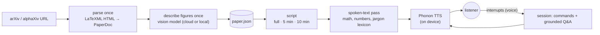

# hearxiv

**Listen to arXiv papers, and talk back to them.**
hearxiv is a free, open-source, voice-first reader for research papers. It is built first for
blind and low-vision researchers in computer science.

- 🎧 **Three ways to listen:** a 5-minute summary, a 10-minute summary, or a full walkthrough of the paper.
- 📊 **Figures are actually described**, at the moment the text first discusses them, by a vision
  model that runs once per paper. Tables and equations are spoken properly too.
- 🗣️ **Interrupt at any time.** Ask "why do they scale by root d k?", "describe figure 3",
  "go to the results" or "where am I?". It answers from the paper, then picks up where you left off.
- 🔈 **On-device speech** with [Gradium's Phonon](https://huggingface.co/gradium/phonon-31m-en)
  (31M parameters, Apache-2.0). It runs at about 3× real time on a 2019 laptop CPU.
- 🆓 **Free forever.** Every component has a zero-cost path: local open models, Gemini's free
  tier, or a shared cache of pre-processed papers.

> Status: **early research prototype (M1).**
> - The pipeline works end to end: parse → describe figures → script → speech → Q&A.
> - There is a local voice-first web app with push-to-talk.
> - Next: hands-free barge-in, streaming answers, and testing with screen-reader users.
>
> See [docs/roadmap.md](docs/roadmap.md).

## Why

- arXiv's own accessibility study found that only 30% of assistive-technology users can access
  the research they need without help, and one participant said "figures are a crapshoot".
- Existing audio tools are either **static** (paper-to-podcast, which you can't question),
  **paid**, or **ignore figures**.

hearxiv combines a structure-aware parser, real figure descriptions, a faithful narrator and a
conversational loop. The novelty is the **presentation logic** that ties these together: what to
say, when, at what depth, and how to recover after an interruption. See [docs/agents.md](docs/agents.md).

## How it works



The detailed diagrams (per-paper ingest, runtime loop, barge-in sequence) are in
[docs/architecture.md](docs/architecture.md).

## Quick start

Requires [uv](https://docs.astral.sh/uv/) and Python 3.12.

```bash
git clone https://github.com/sri-ram-swaminathan/hearxiv && cd hearxiv
uv sync --extra tts --extra svg --extra local
cp .env.example .env                     # optional: OPENAI_API_KEY and/or GEMINI_API_KEY
uv run python -m hearxiv serve           # then open http://localhost:8765
```

### Using the app

1. Paste an arXiv or alphaXiv link and press **Enter**. Or click **Listen with hearxiv** on any
   arXiv or alphaXiv page if the extension is installed (load `extension/` unpacked in Chrome).
2. Choose a **5-minute summary**, a **10-minute summary** or **the whole paper**.
3. It starts talking. **Hold Space** (or the big button) at any time, say something, and let go:
   - "what does that mean?" or "how big was the dataset?" (questions are answered from the paper)
   - "describe figure 2", "read table 1"
   - "go to results", "next section", "go back", "repeat"
   - "slower", "faster", "where am I?", "what can I say?"
4. Keyboard: **K** play/pause · **J / L** back/forward one sentence · **[ / ]** previous/next
   section · **− / =** speed · **W** where am I · **H** help · **T** type a question · **Esc** cancel.

Everything is announced to screen readers through a live region, every control is a real button,
and the current sentence is shown as a large caption (with **A−/A+** text size and dark mode) for
low-vision users. Speech recognition (Moonshine) and speech synthesis (Phonon) both run on your
machine.

### Developer CLI

```bash
# 1. parse + describe figures (once per paper)
uv run python -m hearxiv ingest 1706.03762 --describer openai:gpt-6.1-terra --equations
#    zero-cost alternatives:  --describer gemini:gemini-3.5-flash-lite   (free tier)
#                             --describer hf:Qwen/Qwen3.5-2B             (local CPU, slow)

# 2. read the script (full mode needs no LLM at all)
uv run python -m hearxiv script 1706.03762 --mode full
uv run python -m hearxiv script 1706.03762 --mode 5min

# 3. hear it
uv run python -m hearxiv speak 1706.03762 --mode 5min -o attention.wav

# 4. ask it something
uv run python -m hearxiv ask 1706.03762 "Why do they scale the dot products?"
```

The LLM used for summaries and Q&A is set with `HEARXIV_LLM`: `openai:gpt-6.1-terra` (default),
`gemini:gemini-3.5-flash-lite`, or `local:<model>` for any OpenAI-compatible local server
(llama.cpp, Ollama, LM Studio).

## Which model describes figures best?

See [`notebooks/01_figure_description_benchmark.ipynb`](notebooks/01_figure_description_benchmark.ipynb).
It covers 18 standard seaborn/matplotlib figures with ground truth taken from the plotting code,
10 models (cloud and local CPU), automatic fact checks and an LLM judge. All descriptions are
side by side in [`benchmarks/figure_ocr/DESCRIPTIONS.md`](benchmarks/figure_ocr/DESCRIPTIONS.md).

**Short answer:**

| Model | Quality (0–1) | Hallucinations / figure | Cost / 1,000 figures | Runs |
|---|---|---|---|---|
| `gpt-6.1-terra` (**default**) | **0.93** | 0.22 | $3.09 | cloud |
| `gpt-6.2-astra` | 0.91 | **0.11** | $18.09 | cloud |
| `gpt-6-luna` (best value) | 0.89 | 1.00 | $0.36 | cloud |
| `gemma-4-31b-it` | 0.86 | 1.71 | $0 | cloud (open weights) |
| `gemini-3.5-flash-lite` (zero-cost) | 0.85 | 2.17 | $0 (free tier) | cloud |
| `Qwen3.5-0.8B` | 0.68 | 5.72 | $0 | laptop CPU, ~100 s / figure |
| `SmolVLM-256M` | 0.33 | 1.61 | $0 | laptop CPU |

- **Default: `gpt-6.1-terra`.** A paper costs about 2–3 cents to describe, **once**, and the result is cached.
- **Zero-cost option: Gemini Flash-Lite** works, but it invents about two claims per figure, often numbers.
- **Tiny local models aren't good enough yet.** Quantised 2–4B models through llama.cpp are the next thing
  to test.

Full results, partial runs and caveats are in [`benchmarks/figure_ocr/README.md`](benchmarks/figure_ocr/README.md).

## Repository layout

```
hearxiv/
├── src/hearxiv/
│   ├── schema.py            # PaperDoc: the one-time, cacheable result of ingesting a paper
│   ├── ingest/              # fetch (polite, cached), LaTeXML parser, figure/equation enrichment
│   ├── vision/              # FigureDescriber: openai: / gemini: / hf: / local: backends + prompt
│   ├── narrate/             # script builder (full / N-min), spoken-text pass, jargon lexicon
│   ├── agent/               # Q&A agent + listening session (commands, cursor, resume)
│   ├── tts/                 # Phonon wrapper, earcons
│   ├── llm.py               # one OpenAI-compatible client for every provider
│   └── cli.py               # python -m hearxiv ...
├── benchmarks/figure_ocr/   # seaborn figure suite, runner, scorer, judge, results
├── notebooks/               # experiments (01 = figure-description benchmark)
├── extension/               # Chrome MV3 skeleton: "Listen" button on arXiv / alphaXiv
├── docs/                    # architecture, agents, pronunciation, research notes, roadmap
└── tests/
```

## Contributing

The most valuable contributions right now:
1. **Pronunciations.** Add terms to [`src/hearxiv/narrate/lexicon/cs_ml.json`](src/hearxiv/narrate/lexicon/cs_ml.json)
   (see [docs/pronunciation.md](docs/pronunciation.md)).
2. **Hard figures.** Real paper figures that stump the describers, with a correct description.
3. **Feedback from blind and low-vision researchers** on what to say, when, and how much.

Notes for Windows developers: if Smart App Control is on, use a python.org Python (the project sets
`python-preference = "system"`) and run `python -m hearxiv` rather than the `hearxiv.exe` launcher.

## License

MIT. Phonon weights are Apache-2.0 (Gradium). Paper content belongs to its authors: hearxiv fetches
papers on demand for the person listening and does not redistribute them.
