# Figure descriptions by model

Generated by notebooks/01_figure_description_benchmark.ipynb.

## 01_line_loss_curves · line plot [easy]

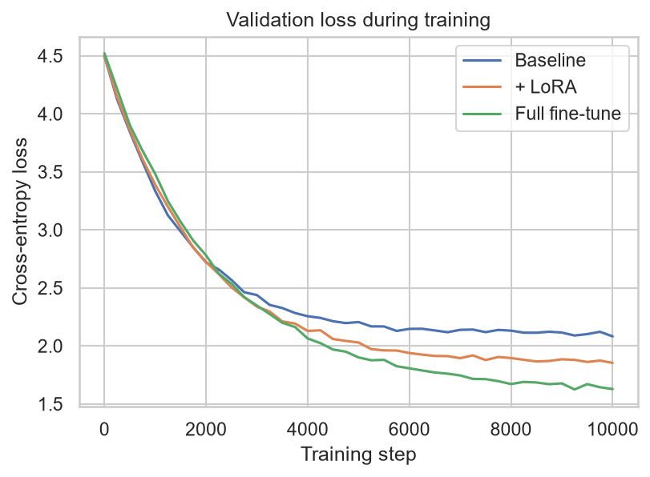

| model | judge acc / compl | facts | description |
|---|---|---|---|
| gpt-6.1-terra | 5 / 5 | 1.00 | This line chart shows validation loss during training for three methods.  The horizontal axis is training step, from 0 to 10,000 steps. The vertical axis is cross-entropy loss, with labeled ticks from 1.5 to 4.5; it does not start at zero. Both axes are linear.  The three series are Baseline in blue, plus LoRA in orange, and Full fine-tune in green.  All three start at about 4.5 loss. At 4,000 steps, Baseline is about 2.25, plus LoRA about 2.13, and Full fine-tune about 2.06. At 6,000 steps, they are about 2.15, 1.94, and 1.80, respectively. At 10,000 steps, they end at about 2.08, 1.85, and 1.63.  Loss drops steeply for all three methods early on, then declines more gradually. After roughly 4,000 steps, Full fine-tune has the lowest loss, plus LoRA is in the middle, and Baseline is highest. The Baseline line levels off near 2.1, while the other two continue to decline. |
| gpt-6-luna | 4 / 5 | 1.00 | This is a single-panel line chart showing validation loss over training for three methods.  The horizontal axis is Training step, from 0 to 10,000, with ticks every 2,000. The vertical axis is Cross-entropy loss, shown from about 1.5 to 4.7, with ticks every 0.5. Both axes are linear; the vertical axis does not start at zero.  The three lines are Baseline in blue, + LoRA in orange, and Full fine-tune in green.  All three start at about 4.5 loss. At 10,000 steps, Baseline is about 2.08, + LoRA about 1.85, and Full fine-tune about 1.62. These ending values are also the lowest visible values for each line. Around 2,000 steps, the lines are clustered near 2.7 to 2.8.  Loss falls steeply at first for all three methods, then declines more gradually. The blue Baseline line is generally highest late in training, orange is in the middle, and green is lowest. The lines cross or come close together early on, but separate later, with Full fine-tune ending lowest. |
| gpt-6.2-astra | 5 / 5 | 0.50 | This line chart shows how validation loss changes during training for three methods.  The horizontal axis is training step, labeled from zero to ten thousand in increments of two thousand. The vertical axis is cross-entropy loss, with no units specified. Its labels run from one point five to four point five in increments of zero point five. Both axes are linear, and the loss axis does not start at zero.  The legend identifies Baseline in blue, plus LoRA in orange, and Full fine-tune in green.  All three start at their highest loss, about four point five, and reach about two point seven five by step two thousand. At step four thousand, loss is about two point two six for Baseline, two point one three for plus LoRA, and two point zero six for Full fine-tune. At step ten thousand, the values are about two point zero eight, one point eight six, and one point six three, respectively. The lowest visible value is about one point six two for Full fine-tune near step nine thousand two hundred fifty.  All three losses fall steeply at first, then decline more slowly. The lines are close together early on but separate later. Baseline levels off first and finishes highest, plus LoRA finishes in the middle, and Full fine-tune finishes lowest. |
| gpt-5.4-mini | 3 / 5 | 1.00 | This is a line chart showing validation loss over training steps for three training methods.  The x-axis is labeled Training step, running from 0 to 10,000 and it starts at zero. The y-axis is labeled Cross-entropy loss, running from about 1.5 to 4.5, and it does not start at zero. There is one panel.  The legend has three series: Baseline in blue, plus LoRA in orange, and Full fine-tune in green.  At step 0, all three start at about 4.5. Around 2,000 steps, all are near 2.7, with Baseline slightly above the others. Around 4,000 steps, Baseline is about 2.25, plus LoRA about 2.12, and Full fine-tune about 2.05. Around 6,000 steps, Baseline is about 2.15, plus LoRA about 1.93, and Full fine-tune about 1.80. At 10,000 steps, Baseline ends near 2.08, plus LoRA near 1.85, and Full fine-tune near 1.62. The lowest visible value is the Full fine-tune curve at the end, about 1.62.  The main pattern is that all three losses fall quickly at first and then flatten out. Full fine-tune performs best throughout most of training, plus LoRA is in the middle, and Baseline is highest. The curves are close early on, then separate more clearly after about 3,000 to 4,000 steps. |
| gemini-3.5-flash-lite | 3 / 5 | 0.50 | This is a line chart showing validation loss during training across three different methods. The horizontal axis is training step, ranging from zero to ten thousand. The vertical axis is cross-entropy loss, ranging from one point five to four point five, and it does start at zero point zero. The legend lists three series: Baseline in blue, plus LoRA in orange, and Full fine-tune in green. All three curves start at the same validation loss of about four point five at training step zero. From there, all three lines decrease rapidly as training progresses. The baseline model in blue decreases the slowest, leveling off around step six thousand and remaining flat near two point one until the end at ten thousand steps. The plus LoRA model in orange decreases faster, reaching a value of about two point one at step four thousand and continuing to decrease gradually to about one point eight five at the end of training. The full fine-tune model in green drops the fastest and lowest, continuing a steady downward trend to reach about one point six three at ten thousand steps. Overall, full fine-tune achieves the lowest validation loss, followed by plus LoRA, with baseline performing the worst. |
| SmolVLM-256M-Instruct | 5 / 0 | 0.00 | Validation loss during training. |

## 02_bar_benchmark_accuracy · bar chart [easy]

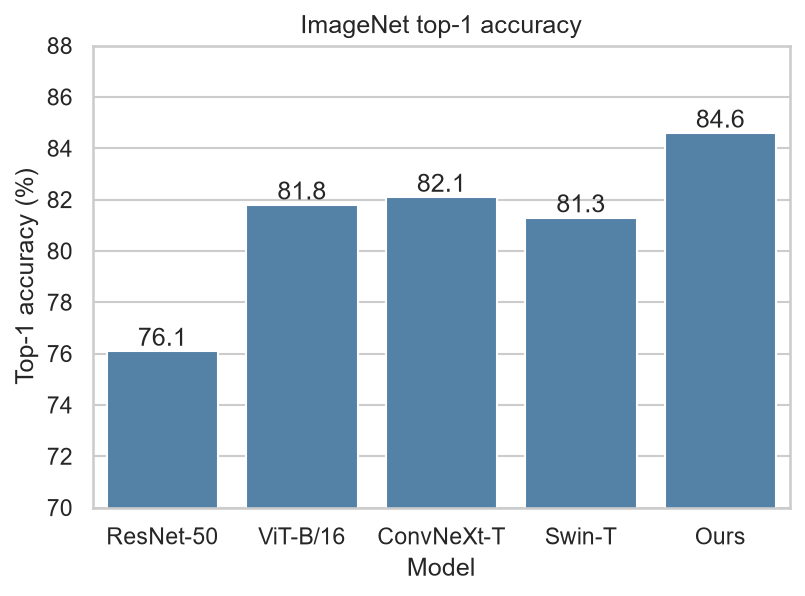

| model | judge acc / compl | facts | description |
|---|---|---|---|
| gpt-6.1-terra | 5 / 5 | 1.00 | This bar chart compares ImageNet top-1 accuracy across five models.  The horizontal axis is labeled Model. The vertical axis is labeled Top-1 accuracy, in percent, and runs from 70 to 88 rather than starting at zero. It is not logarithmic.  From left to right, the models are ResNet-50, ViT-B/16, ConvNeXt-T, Swin-T, and Ours.  Their accuracies are 76.1, 81.8, 82.1, 81.3, and 84.6 percent, respectively.  Ours has the highest accuracy, while ResNet-50 has the lowest. The other three models cluster between 81.3 and 82.1 percent. |
| gpt-6-luna | 4 / 5 | 1.00 | This is a single-panel bar chart comparing ImageNet top-1 accuracy across five models.  The horizontal axis is labeled Model and lists the model names. The vertical axis is labeled Top-1 accuracy, in percent, and runs from 70 to 88 percent in increments of 2; it does not start at zero and is not logarithmic.  The five bars are ResNet-50, ViT-B/16, ConvNeXt-T, Swin-T, and Ours.  Their accuracies are 76.1, 81.8, 82.1, 81.3, and 84.6 percent, respectively. Ours is highest at 84.6 percent, and ResNet-50 is lowest at 76.1 percent.  The four named comparison models cluster between 81.3 and 82.1 percent, while ResNet-50 is noticeably lower. Ours is higher than every comparison model. |
| gpt-6.2-astra | 5 / 5 | 1.00 | This vertical bar chart compares ImageNet top-one accuracy across five models.  The horizontal axis is labeled Model. The vertical axis is labeled Top-one accuracy, in percent. Its scale is linear and starts at 70 rather than zero, with ticks every two percentage points up to 88.  From left to right, the five blue bars represent ResNet-50, ViT-B slash 16, ConvNeXt-T, Swin-T, and Ours.  ResNet-50 scores 76.1 percent. ViT-B slash 16 scores 81.8 percent. ConvNeXt-T scores 82.1 percent. Swin-T scores 81.3 percent. Ours scores 84.6 percent.  Ours ranks highest, 2.5 percentage points above ConvNeXt-T, the runner-up. The three middle bars cluster within 0.8 percentage points of each other. ResNet-50 ranks lowest, 8.5 percentage points below Ours. |
| gpt-5.4-mini | 4 / 5 | 1.00 | This is a bar chart showing ImageNet top-1 accuracy for five models.  The x-axis is labeled Model and lists five categories: ResNet-50, ViT-B/16, ConvNeXt-T, Swin-T, and Ours. The y-axis is labeled Top-1 accuracy (%) and runs from 70 to 88, in 2-point steps; it does not start at zero.  There is one panel and one series of bars, with no legend. The categories are the five model names just listed.  The bar values are 76.1 for ResNet-50, 81.8 for ViT-B/16, 82.1 for ConvNeXt-T, 81.3 for Swin-T, and 84.6 for Ours. The lowest value is ResNet-50 at 76.1, and the highest is Ours at 84.6.  The main pattern is that all four newer models are above ResNet-50 by about 5 to 9 points. Among the non-Ours models, ConvNeXt-T is slightly highest at 82.1, ViT-B/16 is close at 81.8, and Swin-T is a little lower at 81.3. Ours is the clear top performer, about 2.5 points above ConvNeXt-T and about 8.5 points above ResNet-50. |
| gemini-3.5-flash-lite | 5 / 5 | 1.00 | This is a bar chart titled ImageNet top-1 accuracy, which compares the performance of five different computer vision models. The vertical axis is labeled Top-1 accuracy in percent, ranging from 70 to 88, and it does not start at zero. The horizontal axis is labeled Model and lists five categories. There are five vertical bars representing the models. From left to right, their top-1 accuracy values are: ResNet-50 at 76.1 percent, ViT-B/16 at 81.8 percent, ConvNeXt-T at 82.1 percent, Swin-T at 81.3 percent, and Ours at 84.6 percent. Overall, the chart shows that the model labeled Ours achieves the highest top-1 accuracy at 84.6 percent, outperforming the other four models, while ResNet-50 performs the lowest at 76.1 percent. The remaining three models, ViT-B/16, ConvNeXt-T, and Swin-T, form a middle cluster with accuracies between 81.3 and 82.1 percent. |
| SmolVLM-256M-Instruct | 1 / 1 | 0.00 | ImageNet top-1 accuracy is 88. |

## 03_grouped_bar_hue · grouped bar chart [medium]

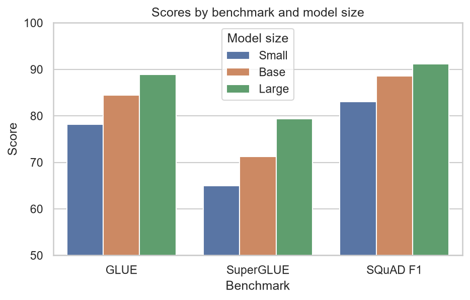

| model | judge acc / compl | facts | description |
|---|---|---|---|
| gpt-6.1-terra | 5 / 5 | 1.00 | This grouped bar chart shows scores on three benchmarks for three model sizes.  The horizontal axis is labeled Benchmark and lists GLUE, SuperGLUE, and SQuAD F1. The vertical axis is labeled Score, with no units shown. It is linear and runs from 50 to 100, so it does not start at zero.  The model size groups are Small, shown in blue; Base, in orange; and Large, in green.  For GLUE, the scores are about 78 for Small, 84.3 for Base, and 88.8 for Large. For SuperGLUE, they are about 64.8, 71.1, and 79.2, respectively. For SQuAD F1, they are about 82.9, 88.4, and 91.  Scores rise with model size on every benchmark. SQuAD F1 has the highest scores for all three sizes, while SuperGLUE has the lowest. The overall maximum is about 91 for Large on SQuAD F1, and the minimum is about 64.8 for Small on SuperGLUE. |
| gpt-6-luna | 5 / 5 | 1.00 | This is a grouped bar chart showing scores across three benchmarks for three model sizes.  It has one panel. The horizontal axis is labeled “Benchmark” and lists GLUE, SuperGLUE, and SQuAD F1. The vertical axis is labeled “Score,” with a range from 50 to 100; it starts at 50 rather than zero. No units or logarithmic scale are indicated.  The legend groups the bars by model size: Small, Base, and Large.  For GLUE, the scores are about 78 for Small, 84 for Base, and 89 for Large. For SuperGLUE, they are about 65, 71, and 79. For SQuAD F1, they are about 83, 89, and 91. The lowest score is about 65 for Small on SuperGLUE, and the highest is about 91 for Large on SQuAD F1.  Within every benchmark, scores rise from Small to Base to Large. SQuAD F1 scores are highest overall, while SuperGLUE scores are lowest. |
| gpt-6.2-astra | 5 / 5 | 1.00 | This grouped bar chart compares scores across three benchmarks for three model sizes.  The horizontal axis is labeled Benchmark. The vertical axis is labeled Score, with no units specified. Its scale is linear and starts at 50 rather than zero, with ticks every 10 up to 100.  From left to right, the benchmark groups are GLUE, SuperGLUE, and SQuAD F1. The legend is labeled Model size. Within each group, the bars run from Small in blue to Base in orange to Large in green.  In that size order, the GLUE scores are about 78, 84, and 89. The SuperGLUE scores are about 65, 71, and 79. The SQuAD F1 scores are about 83, 88, and 91.  Scores rise with model size on every benchmark. The increase from Small to Large is greatest for SuperGLUE, at about 14 points. At every size, SQuAD F1 scores highest, GLUE is next, and SuperGLUE scores lowest. |
| gpt-5.4-mini | 5 / 5 | 1.00 | This is a grouped bar chart showing benchmark scores for three model sizes across three benchmarks.  The x-axis is labeled Benchmark and has three categories: GLUE, SuperGLUE, and SQuAD F1. The y-axis is labeled Score and runs from 50 to 100, in increments of 10; it does not start at zero. There is one panel.  The legend is titled Model size, with three series: Small, Base, and Large.  For GLUE, Small is about 78, Base about 84, and Large about 89. For SuperGLUE, Small is about 65, Base about 71, and Large about 79. For SQuAD F1, Small is about 83, Base about 88.5, and Large about 91.  The main pattern is that scores rise consistently as model size increases for every benchmark. SQuAD F1 is highest overall, GLUE is next, and SuperGLUE is lowest for all three model sizes. The largest gap appears on SuperGLUE, where Large is about 14 points above Small. |
| gemini-3.5-flash-lite | 5 / 5 | 0.50 | This grouped bar chart displays performance scores across three different benchmarks and three model sizes. The vertical axis represents the score, ranging from fifty to one hundred, and does not start at zero. The horizontal axis represents the benchmark, with three categories: GLUE, SuperGLUE, and SQuAD F1. The legend shows three model sizes: Small in blue, Base in orange, and Large in green. For the GLUE benchmark, the Small model scores about seventy-eight, the Base model scores about eighty-four, and the Large model scores about eighty-nine. For the SuperGLUE benchmark, the Small model scores sixty-five, the Base model scores about seventy-one, and the Large model scores about seventy-nine. For the SQuAD F1 benchmark, the Small model scores about eighty-three, the Base model scores about eighty-eight, and the Large model scores about ninety-one. Across all benchmarks, performance consistently increases as model size increases from Small to Base to Large. Additionally, SuperGLUE generally yields the lowest scores across all model sizes, while SQuAD F1 and GLUE achieve higher scores, with SQuAD F1 reaching the highest overall score of about ninety-one for the Large model. |
| SmolVLM-256M-Instruct | 1 / 1 | 0.00 | GLE, SUPERGLE, QUADF, SQUAD F1, BLACK, BLACK, BLACK, BLACK, BLACK, BLACK, BLACK, BLACK, BLACK, BLACK, BLACK, BLACK, BLACK, BLACK, BLACK, BLACK, BLACK, BLACK, BLACK, BLACK, BLACK, BLACK, BLACK, BLACK, BLACK, BLACK, BLACK, BLACK, BLACK, BLACK, BLACK, BLACK, BLACK, BLACK, BLACK, BLACK, BLACK, BLACK, BLACK, BLACK, BLACK, BLACK, BLACK, BLACK, BLACK, BLACK, BLACK, BLACK, BLACK, BLACK, BLACK, BLACK, BLACK, BLACK, BLACK, BLACK, BLACK, BLACK, BLACK, BLACK, BLACK, BLACK, BLACK, BLACK, BLACK, BLACK, BLACK, BLACK, BLACK, BLACK, BLACK, BLACK, BLACK, BLACK, BLACK, BLACK, BLACK, BLACK, BLACK, BLACK, BLACK, BLACK, BLACK, BLACK, BLACK, BLACK, BLACK, BLACK, BLACK, BLACK, BLACK, BLACK, BLACK, BLACK, BLACK, BLACK, BLACK, BLACK, BLACK, BLACK, BLACK, BLACK, BLACK, BLACK, BLACK, BLACK, BLACK, BLACK, BLACK, BLACK, BLACK, BLACK, BLACK, BLACK, BLACK, BLACK, BLACK, BLACK, BLACK, BLACK, BLACK, BLACK, BLACK, BLACK, BLACK, BLACK, BLACK, BL |

## 04_heatmap_confusion_annotated · heatmap (confusion matrix) [medium]

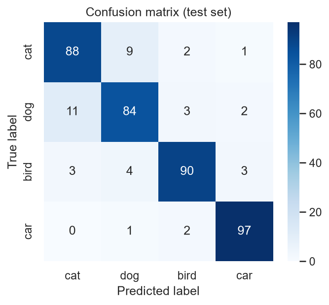

| model | judge acc / compl | facts | description |
|---|---|---|---|
| gpt-6.1-terra | 5 / 5 | 1.00 | This is a confusion matrix heat map showing test-set true labels against predicted labels.  The horizontal axis is Predicted label, and the vertical axis is True label. Both are categorical, with no units or numerical ranges. Each lists cat, dog, bird, and car, in that order. The blue color scale has labeled ticks from 0 to 80, in steps of 20; darker blue indicates higher values.  Reading across each row in predicted-label order, the true cat row is 88, 9, 2, and 1. The dog row is 11, 84, 3, and 2. The bird row is 3, 4, 90, and 3. The car row is 0, 1, 2, and 97.  The largest values lie on the diagonal, where true and predicted labels match. Car has the highest diagonal value, 97, and dog the lowest, 84. The largest off-diagonal value is 11, for true dogs predicted as cats. The minimum is 0, for true cars predicted as cats. |
| gpt-6-luna | 4 / 5 | 1.00 | This is a single-panel confusion-matrix heatmap showing the test-set counts for true labels compared with predicted labels.  The horizontal axis is “Predicted label” and the vertical axis is “True label.” Both use the categories cat, dog, bird, and car, with no numerical axis range or units. The color scale runs from 0 to 100, marked in steps of 20; it is not logarithmic.  The four categories, in order on both axes, are cat, dog, bird, and car.  For true cats, the counts predicted as cat, dog, bird, and car are 88, 9, 2, and 1. For true dogs, they are 11, 84, 3, and 2. For true birds, they are 3, 4, 90, and 3. For true cars, they are 0, 1, 2, and 97. The largest value is 97 for cars correctly predicted as cars; the smallest is 0 for cars predicted as cats.  The diagonal values are highest in each row, indicating the most frequent prediction matches the true label. Cars have the highest diagonal count, followed by birds, cats, and dogs. The largest off-diagonal counts are 11 dogs predicted as cats and 9 cats predicted as dogs. |
| gpt-6.2-astra | 5 / 5 | 0.40 | This four-by-four confusion matrix is a heat map showing how test set predictions compare with true labels.  The horizontal axis shows the predicted label, and the vertical axis shows the true label. Both axes are categorical. The color key runs from pale blue for lower counts to dark blue for higher counts, with labeled ticks from zero to eighty in steps of twenty.  The categories are cat, dog, bird, and car, in that order both from left to right and from top to bottom.  Reading across each row in predicted-label order: for true cat, the counts are eighty-eight, nine, two, and one. For true dog, they are eleven, eighty-four, three, and two. For true bird, they are three, four, ninety, and three. For true car, they are zero, one, two, and ninety-seven.  The dark diagonal stands out: correct predictions dominate every row. Car has the most correct predictions, followed by bird, cat, and dog. The two largest errors are between cats and dogs: eleven dogs were labeled cat, and nine cats were labeled dog. No cars were labeled cat. |
| gpt-5.4-mini | 5 / 5 | 1.00 | This is a confusion matrix heatmap showing how often four classes were predicted correctly or confused with each other on the test set.  The x-axis is Predicted label and the y-axis is True label. Both axes list the categories cat, dog, bird, and car. There is one panel, and the color scale on the right runs from 0 up to about 100, with darker blue meaning higher counts. The chart does not use logarithmic axes.  The series or groups are the four class labels cat, dog, bird, and car, arranged as rows and columns of the matrix.  The diagonal values are 88 for cat, 84 for dog, 90 for bird, and 97 for car. Off-diagonal values are cat misread as dog 9, bird 2, car 1; dog misread as cat 11, bird 3, car 2; bird misread as cat 3, dog 4, car 3; and car misread as cat 0, dog 1, bird 2. The largest single value is 97 for true car predicted as car, and the smallest is 0 for true car predicted as cat.  The main pattern is that most counts are on the diagonal, so classification is generally strong. Car is the best recognized class, followed by bird, cat, and dog. The most notable confusions are between cat and dog, especially dog predicted as cat at 11 and cat predicted as dog at 9. |
| gemini-3.5-flash-lite | 5 / 5 | 0.40 | This is a confusion matrix for a test set, showing the performance of a classification model across four classes. The horizontal axis is labeled Predicted label and lists cat, dog, bird, and car. The vertical axis is labeled True label and lists cat, dog, bird, and car from top to bottom. A vertical color bar on the right ranges from zero to over eighty, with darker shades of blue representing higher counts. For the true cat class, eighty-eight instances were correctly predicted as cat, nine as dog, two as bird, and one as car. For the true dog class, eleven were predicted as cat, eighty-four as dog, three as bird, and two as car. For the true bird class, three were predicted as cat, four as dog, ninety as bird, and three as car. For the true car class, zero were predicted as cat, one as dog, two as bird, and ninety-seven as car. The main pattern shows that the model performs best on the car class with ninety-seven correct predictions and very few misclassifications. The cat and dog classes show the highest confusion with each other, with eleven true dogs misclassified as cats and nine true cats misclassified as dogs. Overall, the diagonal elements contain the highest numbers for every class, indicating generally high accuracy across all four categories. |
| SmolVLM-256M-Instruct | 5 / 1 | 0.00 | Confusion matrix (test set). |

## 05_heatmap_attention_unannotated · heatmap (attention map) [hard]

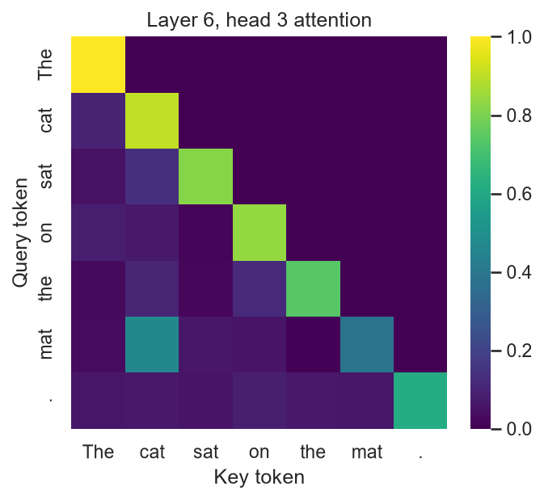

| model | judge acc / compl | facts | description |
|---|---|---|---|
| gpt-6.1-terra | 4 / 4 | 1.00 | This is a heat map titled “Layer 6, head 3 attention,” showing attention values between query and key tokens.  The horizontal axis is labeled “Key token,” and the vertical axis is labeled “Query token.” Both list the same seven tokens in order: capitalized “The,” “cat,” “sat,” “on,” lowercase “the,” “mat,” and a period. The color scale runs from 0 to 1, with dark purple near zero and yellow at 1.  The main diagonal values, in token order, are about 1.0, 0.91, 0.82, 0.84, 0.74, 0.38, and 0.63. The largest off-diagonal value is about 0.47, for the query “mat” and the key “cat.” Other visible off-diagonal values are mostly below 0.15.  Attention is concentrated along the diagonal, where each query attends to the matching key. The “mat” query is the exception: it attends more strongly to “cat” than to itself. Cells above the diagonal are near zero. |
| gpt-6-luna | 5 / 4 | 0.75 | This is a single-panel attention heat map showing how strongly each query token attends to each key token.  The horizontal axis is Key token and the vertical axis is Query token. Both axes show the seven tokens, in order: “The,” “cat,” “sat,” “on,” “the,” “mat,” and a period. The color scale runs from 0 to 1; the axes are categorical, not numeric.  The panel is titled “Layer 6, head 3 attention.” There is no separate legend; the color bar indicates attention strength, from dark purple near zero to yellow at 1.  The strongest cell is “The” attending to “The,” at 1.0. Other strong diagonal values are about 0.9 for “cat” to “cat,” 0.8 for “sat” to “sat,” 0.85 for “on” to “on,” and 0.75 for “the” to “the.” The “mat” query attends most to “cat,” at about 0.45, and to “mat,” at about 0.35. The period query attends most to itself, at about 0.6. Most remaining cells are below about 0.15.  Overall, attention is concentrated along the diagonal for the first five tokens. The main off-diagonal exception is “mat” attending to “cat.” |
| gpt-6.2-astra | 4 / 4 | 0.75 | This heatmap, titled “Layer 6, head 3 attention,” shows attention values for pairs of tokens in the sentence “The cat sat on the mat.”  The horizontal axis is labeled “Key token,” and the vertical axis is labeled “Query token.” Both axes are categorical. The categories, from left to right and from top to bottom, are capital T The, cat, sat, on, lowercase the, mat, and a period. The linear color scale on the right runs from zero in dark purple to one in yellow, with ticks every zero point two.  Along the diagonal, where the query and key are the same token, attention is about one for capital T The, about zero point nine one for cat, about zero point eight two for sat, about zero point eight four for on, about zero point seven four for lowercase the, about zero point three eight for mat, and about zero point six two for the period.  The diagonal has the highest value in every row except mat. In that row, attention to cat is about zero point four seven, higher than attention to mat itself. All cells above the diagonal are at or near zero, and most cells below it are also dark purple. |
| gpt-5.4-mini | 4 / 3 | 0.75 | This is a heatmap showing attention strengths from one transformer head, with query tokens on the vertical axis and key tokens on the horizontal axis.  The x-axis is labeled Key token and the y-axis is labeled Query token. Both axes list the tokens The, cat, sat, on, the, mat, and a period. The color scale runs from 0.0 to 1.0, with darker purple meaning lower attention and yellow meaning higher attention. There is one panel.  There is no legend beyond the token labels and the colorbar. The highlighted cells are on the diagonal and a few off-diagonal positions.  The largest value is at query The attending to key The, at 1.0. Query cat to key cat is about 0.9. Query sat to key sat is about 0.8. Query on to key on is about 0.8. The second the, at query the and key the, is about 0.75. Query mat to key mat is about 0.4 to 0.5. Query period to key period is about 0.65. A noticeable off-diagonal value is query mat to key cat at about 0.5. Most other cells are near zero, roughly 0.0 to 0.1.  The main pattern is a strong mostly diagonal attention structure, meaning each token mostly attends to itself or nearby earlier tokens, with especially strong attention on The, cat, sat, and on. The mat row is the most spread out, with a clear extra focus on cat. The period row is moderate and fairly distributed, while the rest of the matrix is very dark and low. |
| gemini-3.5-flash-lite | 3 / 5 | 1.00 | This is a heatmap displaying attention weights for Layer 6, Head 3 of a transformer model processing the sentence The cat sat on the mat. The vertical axis lists the query tokens, which are The, cat, sat, on, the, mat, and period, ordered from top to bottom. The horizontal axis lists the corresponding key tokens, in the same order from left to right. A vertical color bar on the right side represents attention values ranging from 0.0 to 1.0, where dark purple indicates low attention near 0.0 and bright yellow indicates high attention near 1.0. The attention matrix shows a clear autoregressive pattern, where each token primarily attends to itself and preceding tokens. Specifically, the diagonal elements show high attention weights, with The attending strongly to itself at 1.0, cat attending to itself at about 0.85, sat attending to itself at about 0.8, on attending to itself at about 0.8, the attending to itself at about 0.7, mat attending to itself at about 0.45, and the period attending to itself at about 0.65. Additionally, the query token mat displays a notable secondary attention weight of about 0.5 directed backward toward the key token cat. All other token pairs show very low attention weights close to 0.0, forming a dark triangular region above the diagonal. |
| SmolVLM-256M-Instruct | 2 / 1 | 0.25 | The key token is the cat. sat is on sat. The mat is on sat. The mat is on sat. The mat is on sat. The mat is on sat. The mat is on sat. The mat is on sat. The mat is on sat. The mat is on sat. The mat is on sat. |

## 06_scatter_hue · scatter plot [medium]

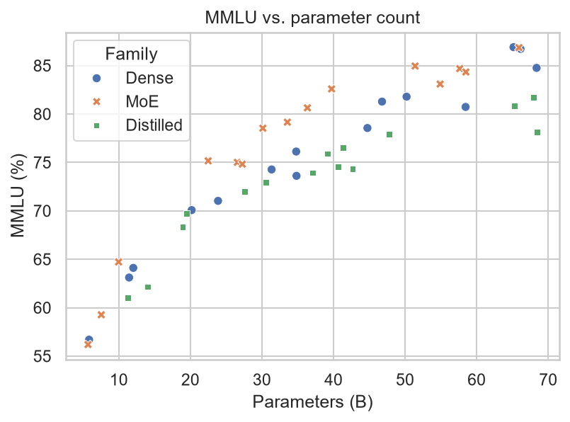

| model | judge acc / compl | facts | description |
|---|---|---|---|
| gpt-6.1-terra | 5 / 4 | 0.75 | This scatter plot shows MMLU scores against model parameter counts.  The horizontal axis is Parameters, in billions, spanning about 3 to 72 billion. The vertical axis is MMLU, in percent, spanning about 55 to 88 percent. Both axes are linear and neither starts at zero.  The legend identifies three families: Dense, shown as blue circles; MoE, as orange crosses; and Distilled, as green squares.  Dense points range from about 5.8 billion parameters and 56.7 percent to a high of about 65 billion and 86.9 percent. The rightmost Dense point is about 68 billion and 84.8 percent. MoE ranges from about 5.7 billion and 56.2 percent to about 66 billion and 86.9 percent. Distilled ranges from about 11 billion and 61 percent to a high of about 68 billion and 81.7 percent; its rightmost point is about 68.5 billion and 78.1 percent.  Scores generally rise with parameter count, though there is variation at similar sizes. MoE points are often above Dense and Distilled points, while Distilled points generally score lowest. At the high end, Dense and MoE reach nearly 87 percent, while Distilled remains below 82 percent. |
| gpt-6-luna | 5 / 4 | 0.75 | This is a single scatter plot showing MMLU scores against parameter count for three model families.  The horizontal axis is Parameters (B), ranging from about 3 to 72 billion, with labeled ticks from 10 to 70; it is linear and does not start at zero. The vertical axis is MMLU (percent), ranging from about 55 to 88 percent, with labeled ticks from 55 to 85; it is linear and also does not start at zero.  The legend groups the points into Dense, shown as blue circles; MoE, shown as orange crosses; and Distilled, shown as green squares.  Dense scores range from about 57 percent at 6 billion parameters to about 87 percent at 65 billion. MoE ranges from about 56 percent at 6 billion to about 87 percent at 66 billion. Distilled ranges from about 61 percent at 11 billion to about 82 percent at 68 billion. There are no connecting lines.  Scores generally rise as parameter count increases. MoE is often highest in the middle parameter range, while Dense and MoE reach similar top scores at the largest counts. Distilled scores are generally lower, particularly at high parameter counts. |
| gpt-6.2-astra | 5 / 4 | 0.50 | This scatter plot shows how M M L U scores vary with parameter count across three model families.  The horizontal axis is parameter count in billions. It runs from about 3 to 72, with labels every 10 billion from 10 to 70. The vertical axis is M M L U in percent. It runs from just under 55 to about 88, with labels every 5 percentage points from 55 to 85. Both axes are linear, and neither starts at zero.  The legend, titled Family, identifies Dense as blue circles, M o E as orange crosses, and Distilled as green squares.  Dense starts at about 57 percent at 6 billion parameters, peaks at about 87 percent at 65 billion, and ends at about 85 percent at 68 billion. M o E starts at about 56 percent at 6 billion, reaches about 75 percent at 22 billion, and ends at its peak of about 87 percent at 66 billion. Distilled starts at about 61 percent at 11 billion, peaks at about 82 percent at 68 billion, and ends at about 78 percent just beyond 68 billion.  Scores generally rise with parameter count, though not steadily. At comparable counts in the middle of the plot, M o E generally scores highest and Distilled lowest. Near 66 billion, the highest Dense and M o E scores nearly coincide. |
| gpt-5.4-mini | 4 / 4 | 0.75 | This is a scatter plot showing MMLU accuracy versus parameter count for three model families.  The x-axis is labeled Parameters, in billions, and runs from about 5 to 70; it does not start at zero. The y-axis is labeled MMLU, in percent, and runs from about 55 to 88; it also does not start at zero. There is one panel.  The legend is titled Family, with three series: Dense in blue circles, MoE in orange x marks, and Distilled in green squares.  The main visible points are: Dense starts at about 56.5 percent at 6 billion and about 59 percent at 8 billion, then rises through about 64 at 12 billion, 70 at 20 billion, 71 at 23 billion, 74 at 31 billion, 76 at 34 billion, 78.5 at 44 billion, 81 at 47 billion, 81.7 at 50 billion, 80.6 at 59 billion, 87 at 65 billion, and about 84.7 at 68 billion. MoE starts at about 56 at 6 billion and 59 at 8 billion, then about 64.7 at 10 billion, 75 at 22 billion, 75 at 27 billion, 78.5 at 30 billion, 79 at 33 billion, 80.5 at 36 billion, 82.5 at 40 billion, 85 at 52 billion, 83 at 55 billion, 84.5 at 58 billion, 84.5 at 59 billion, and about 86.8 at 66 billion. Distilled starts at about 61 at 11 billion, 62 at 14 billion, 68.5 at 19 billion, 69.7 at 20 billion, 71.8 at 27 billion, 72.8 at 30 billion, 73.8 at 37 billion, 74.5 at 41 billion, 74.2 at 43 billion, 77.7 at 47 billion, 80.7 at 65 billion, and 78 at 68 billion.  The overall pattern is that MMLU increases with parameter count for all three families. MoE is usually highest, Dense is generally in the middle, and Distilled is usually lowest. The highest point is about 87 percent for Dense around 65 billion parameters, and the lowest points are around 56 percent at about 6 billion parameters. |
| gemini-3.5-flash-lite | 3 / 4 | 0.50 | This is a scatter plot showing model performance on the Mapped Multi-Task Language Understanding benchmark versus parameter count. The horizontal axis represents parameters in billions, ranging from roughly 5 to 70. The vertical axis represents Mapped Multi-Task Language Understanding percentage, ranging from 55 to 87, and the axis starts at 55 rather than zero. The legend categorizes data points into three families: dense models represented by blue circles, mixture of experts models represented by orange crosses, and distilled models represented by green squares. Overall, performance increases for all model families as parameter count increases, but mixture of experts models consistently achieve higher accuracy than dense or distilled models of similar parameter sizes. The lowest scores occur near six billion parameters, with dense and mixture of experts models both scoring around 56 percent. The highest scores reach approximately 87 percent Mapped Multi-Task Language Understanding around 65 billion parameters, achieved by both a dense and a mixture of experts model. Across almost all parameter sizes, mixture of experts models form the upper frontier of performance, while distilled models generally score lower than dense models at comparable parameter counts. |
| SmolVLM-256M-Instruct | 3 / 1 | 0.00 | Family MLOU vs. parameter count. |

## 07_box_latency · box plot [medium]

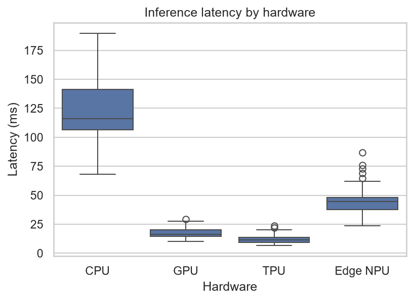

| model | judge acc / compl | facts | description |
|---|---|---|---|
| gpt-6.1-terra | 5 / 5 | 1.00 | This box plot shows the distribution of inference latency across four types of hardware.  The horizontal axis is labeled Hardware. The vertical axis is labeled Latency, in milliseconds, and is linear. It extends from slightly below zero to about 200 milliseconds, with labeled ticks from zero to 175.  The four groups are CPU, GPU, TPU, and Edge NPU.  For CPU, the median is about 116 milliseconds, the box extends from about 106 to 141, and the whiskers extend from about 68 to 190. For GPU, the median is about 16 milliseconds, the box spans about 14 to 20, and the whiskers span about 10 to 28, with an outlier at about 29. For TPU, the median is about 11 milliseconds, the box spans about 9 to 14, and the whiskers span about 7 to 20, with outliers around 22 and 24. For Edge NPU, the median is about 44 milliseconds, the box spans about 38 to 48, and the whiskers span about 24 to 62. Its high outliers are approximately 65, 69, 73, 76, and 87 milliseconds.  CPU has the highest latency and the widest spread. Edge NPU is next, while GPU and TPU are much lower, with TPU having the lowest median. |
| gpt-6-luna | 4 / 5 | 1.00 | This is a box-and-whisker chart comparing inference latency across four hardware types.  The horizontal axis is Hardware, with categories rather than a numeric scale. The vertical axis is Latency in milliseconds; it starts at zero, is not logarithmic, and has labeled ticks every 25 milliseconds from zero to 175, with the plot extending to about 200.  The groups are CPU, GPU, TPU, and Edge NPU.  For CPU, the median is about 116 milliseconds, the box spans about 106 to 141, and the whiskers run from about 68 to 190. GPU has a median near 16, a box from about 14 to 20, whiskers from about 10 to 27, and one outlier near 29. TPU has a median near 11, a box from about 9 to 14, whiskers from about 6 to 20, and outliers around 22 to 24. Edge NPU has a median near 44, a box from about 37 to 48, whiskers from about 23 to 62, and several high outliers, from about 64 up to 87.  CPU has the highest typical latency and widest spread. TPU has the lowest median, followed by GPU. Edge NPU is between those groups, with several high outliers. |
| gpt-6.2-astra | 5 / 5 | 1.00 | This box and whisker plot compares the distribution of inference latency across four types of hardware.  The horizontal axis is labeled Hardware and is categorical. The vertical axis is labeled Latency in milliseconds. Its scale is linear, with ticks from zero to 175 in steps of 25. The plotting area extends slightly below zero and up to about 200 milliseconds.  From left to right, the groups are CPU, GPU, TPU, and Edge NPU.  For the CPU, the median is about 116 milliseconds. The box spans about 106 to 141 milliseconds, and the whiskers reach about 68 and 190. For the GPU, the median is about 16 milliseconds, the box spans about 14 to 20, and the whiskers reach about 10 and 28. For the TPU, the median is about 12 milliseconds, the box spans about 9 to 14, and the whiskers reach about 7 and 20. For the Edge NPU, the median is about 45 milliseconds, the box spans about 38 to 48, and the whiskers reach about 24 and 62.  The CPU has the highest median and the widest spread, followed in median latency by the Edge NPU, GPU, and TPU. High outliers appear at about 29 milliseconds for the GPU, around 22 to 24 for the TPU, and from about 65 to 87 for the Edge NPU. No CPU outliers are marked. |
| gpt-5.4-mini | 5 / 4 | 1.00 | This is a box-and-whisker plot showing inference latency for four kinds of hardware.  The x-axis is Hardware with four categories: CPU, GPU, TPU, and Edge NPU. The y-axis is Latency in milliseconds, ranging from about 0 up to a little over 190, and it is a linear scale that does not start at zero on the visible plotting area, though zero is shown at the bottom.  There is one panel. The four groups are CPU, GPU, TPU, and Edge NPU.  For CPU, the median is about 116 ms, the box runs from about 106 to 141 ms, and the whiskers extend from about 68 to 188 ms. For GPU, the median is about 17 ms, the box is about 14 to 20 ms, and the whiskers are about 10 to 27 ms with one high outlier near 29 ms. For TPU, the median is about 11 ms, the box is about 9 to 13 ms, and the whiskers are about 7 to 20 ms with outliers around 22 to 24 ms. For Edge NPU, the median is about 43 ms, the box is about 37 to 48 ms, the whiskers are about 24 to 62 ms, and there are several high outliers around 65, 68, 72, 75, and 87 ms.  The main pattern is that CPU is by far the slowest, TPU is the fastest, GPU is slightly slower than TPU, and Edge NPU is in between but with several high outliers. |
| gemini-3.5-flash-lite | 4 / 5 | 0.75 | This box plot chart compares the inference latency across four different types of hardware. The vertical axis is labeled Latency in milliseconds, ranging from zero to one hundred seventy-five in increments of twenty-five, starting at zero. The horizontal axis is labeled Hardware and displays four categories: CPU, GPU, TPU, and Edge NPU. There are no sub-panels or legends. The categories from left to right show the distribution of latency measurements for each hardware type. The CPU has the highest latency, with a median of about one hundred sixteen milliseconds, a box spanning from about one hundred six to one hundred forty-one milliseconds, and whiskers extending from sixty-eight to one hundred ninety milliseconds. The GPU shows much lower latency, with a median of about sixteen milliseconds, a box from fourteen to twenty milliseconds, whiskers from ten to twenty-seven milliseconds, and one outlier at twenty-nine milliseconds. The TPU has the lowest latency, with a median of about twelve milliseconds, a box from ten to fourteen milliseconds, whiskers from seven to twenty milliseconds, and two outliers near twenty-four milliseconds. The Edge NPU has a median latency of about forty-four milliseconds, a box from thirty-eight to forty-eight milliseconds, whiskers from twenty-four to sixty-two milliseconds, and several outliers extending up to eighty-seven milliseconds. Overall, the TPU is the fastest hardware with the lowest latency, followed closely by the GPU, while the CPU is by far the slowest with the highest latency and the widest spread of results. |
| SmolVLM-256M-Instruct | 5 / 1 | 0.00 | Inference latency by hardware. |

## 08_violin_split · violin plot [hard]

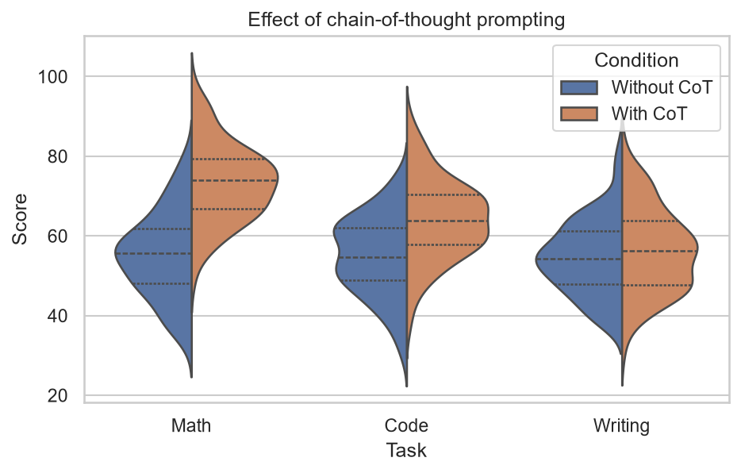

| model | judge acc / compl | facts | description |
|---|---|---|---|
| gpt-6.1-terra | 5 / 5 | 1.00 | This split violin chart shows score distributions for three tasks, comparing performance with and without chain-of-thought prompting.  There is one panel. The horizontal axis is labeled Task and lists Math, Code, and Writing. The vertical axis is labeled Score, with no units shown. It is linear and runs from about 18 to 110, with labeled ticks from 20 to 100, so it does not start at zero.  Each violin is split into two groups: blue for Without CoT and orange for With CoT.  The middle horizontal marks are at about 55 without CoT and 74 with CoT for Math, about 55 and 64 for Code, and about 54 and 56 for Writing. The outer horizontal marks are roughly 48 and 62 without CoT and 67 and 79 with CoT for Math; 49 and 62 without and 58 and 70 with for Code; and 48 and 61 without and 48 and 64 with for Writing.  With CoT, the distributions shift noticeably higher for Math and Code, especially Math. The Writing distributions overlap much more, with their middle marks only about two points apart. Among the three tasks, Math with CoT has the highest middle mark. |
| gpt-6-luna | 5 / 5 | 1.00 | This is a set of three split violin plots comparing score distributions with and without chain-of-thought prompting across three tasks.  The horizontal axis is Task, with Math, Code, and Writing; it has no numeric scale. The vertical axis is Score, with labeled ticks from 20 to 100 in steps of 20. It is a linear scale and does not start at zero; the plotted range extends from about 18 to 110.  The legend names the blue half Without CoT and the orange half With CoT. Each violin shows a distribution, with dashed lines marking the lower quartile, median, and upper quartile.  For Math, the medians are about 55 without CoT and 74 with CoT; the quartile ranges are about 48 to 62 and 67 to 79. For Code, the medians are about 54 and 64, with quartile ranges of about 49 to 62 and 58 to 70. For Writing, the medians are about 54 and 56, with ranges of about 48 to 61 and 47 to 64.  With CoT scores are higher in Math and Code, especially in Math. Writing scores are similar between conditions, with broadly overlapping distributions. |
| gpt-6.2-astra | 5 / 5 | 1.00 | This split violin chart compares score distributions with and without chain-of-thought prompting across three tasks.  The horizontal axis, labeled Task, lists Math, Code, and Writing from left to right. The vertical axis, labeled Score, is linear and does not start at zero. It extends from about 18 to 110, with labeled ticks from 20 to 100 in steps of 20. No score unit is shown.  The legend is labeled Condition. For each task, the blue left half is Without CoT, and the orange right half is With CoT. Wider portions indicate a greater concentration of scores.  The three horizontal marks in each half show the lower quartile, median, and upper quartile. For Math, these are about 48, 56, and 62 without prompting, versus about 67, 74, and 79 with prompting. For Code, they are about 49, 55, and 62 without, versus about 58, 64, and 70 with. For Writing, they are about 48, 54, and 61 without, versus about 48, 56, and 64 with.  Without prompting, the three tasks have similar medians. With prompting, Math shows the largest median increase, about 18 points, followed by Code at about 9 points. Writing changes least, with a median increase of about 2 points and substantial overlap between conditions. |
| gpt-5.4-mini | 4 / 4 | 1.00 | This is a split violin chart showing the distribution of score for three tasks, comparing results without chain-of-thought prompting and with chain-of-thought prompting.  The x-axis is Task, with three categories: Math, Code, and Writing. The y-axis is Score, with visible ticks at about 20, 40, 60, 80, and 100; it does not start at zero. There is one panel.  The legend is titled Condition, with two series: Without CoT in blue and With CoT in orange.  For Math, Without CoT is centered around the mid-50s, with dashed quartile lines at about 48, 56, and 62; With CoT is centered higher, around the mid-70s, with quartiles about 66, 74, and 79. For Code, Without CoT is around the low-to-mid 50s, with quartiles about 49, 55, and 62; With CoT is around the low 60s, with quartiles about 58, 64, and 70. For Writing, Without CoT is around the low-to-mid 50s, with quartiles about 48, 55, and 61; With CoT is around the mid-50s to low 60s, with quartiles about 48, 56, and 64. The overall ranges reach roughly from the low 30s up to about 100.  The main pattern is that With CoT is higher than Without CoT for Math and Code, especially Math, while Writing shows a smaller difference. Math with CoT has the highest scores, and the no-CoT groups cluster in the mid-50s across all three tasks. |
| gemini-3.5-flash-lite | 3 / 5 | 1.00 | This is a grouped violin plot titled Effect of chain-of-thought prompting, comparing performance scores across three different tasks. The horizontal axis represents the task, with three categories labeled Math, Code, and Writing. The vertical axis represents the score, ranging from 20 to 100, starting from 20 rather than zero. The legend displays two conditions: Without CoT in blue on the left side of each violin, and With CoT in orange on the right side. Each violin contains three dashed horizontal lines representing the lower quartile, median, and upper quartile values. For the Math task, the Without CoT condition spans from about 25 to 80, with a median score of 55 and quartiles around 48 and 62. The With CoT condition for Math shifts noticeably higher, spanning from about 35 to over 105, with a median score of 74 and quartiles around 67 and 79. For the Code task, the Without CoT condition ranges from about 22 to 80 with a median of 55, while the With CoT condition ranges from about 25 to 98 with a median of 64. For the Writing task, both conditions overlap closely, with Without CoT showing a median of 54 and With CoT showing a median of 56, both spanning roughly from 22 to 86. Overall, chain-of-thought prompting provides the largest performance boost on Math, a moderate boost on Code, and almost no visible effect on Writing. |
| SmolVLM-256M-Instruct | 1 / 1 | 0.75 | The effect of chain-of-thought prompting is a plot with three panels. The x-axis represents Math Task, the y-axis represents Code Task, and the legend or groups is labeled as Math, Code, and Writing. The plot shows a trend of increasing scores as the number of panels increases. The highest score is 100, followed by 80, 70, and 60. The lowest score is 40, 30, and 20. |

## 09_hist_kde · histogram with KDE [medium]

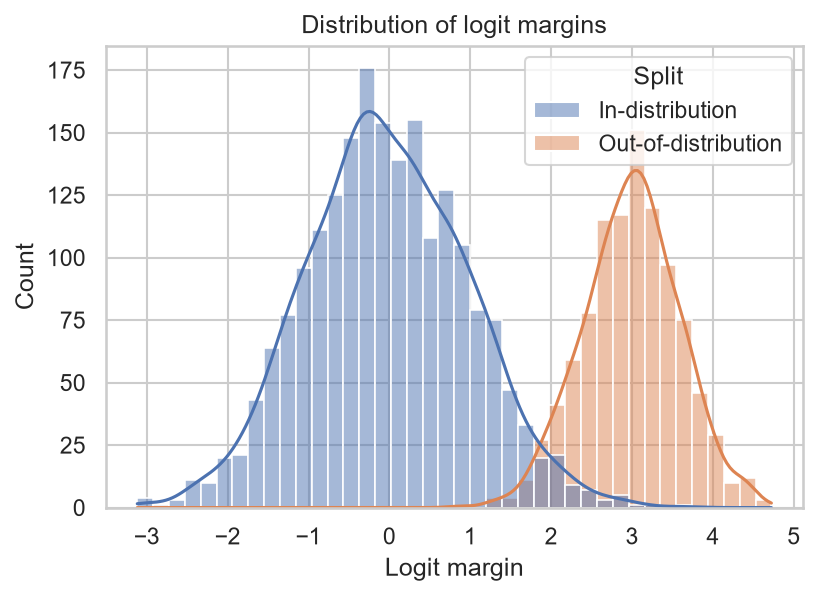

| model | judge acc / compl | facts | description |
|---|---|---|---|
| gpt-6.1-terra | 4 / 4 | 1.00 | This is an overlaid histogram with smooth curves showing the distributions of logit margins for two groups.  The horizontal axis is logit margin, ranging from about minus 3.5 to 5.1, so it does not start at zero. The vertical axis is count, ranging from zero to about 185. Both axes are linear.  The legend identifies the blue series as in-distribution and the orange series as out-of-distribution.  The in-distribution bars extend from about minus 3.1 to 3.4, with the tallest bar reaching 175 near minus 0.3. Its smooth curve peaks at about 158 near the same margin. The out-of-distribution bars extend from about 1.2 to 4.7, with the tallest bar reaching about 137 near 3.1. Its smooth curve peaks at about 135 near 3.1.  The in-distribution values are broadly spread around zero, while the out-of-distribution values form a narrower cluster around 3. The groups overlap mainly between margins of about 1.5 and 2.5, and their smooth curves cross near 1.9. |
| gpt-6-luna | 4 / 4 | 0.75 | This is an overlaid histogram with smooth density curves, showing the distributions of logit margins for two splits.  The horizontal axis is labeled “Logit margin,” runs from about minus 3.5 to 5, and is linear. The vertical axis is labeled “Count,” runs from 0 to about 185, and is also linear.  The two groups are In-distribution, shown in blue, and Out-of-distribution, shown in orange.  The tallest blue bar is about 175, near a logit margin of minus 0.3; its smooth curve peaks near 160. The tallest orange bar is about 135, near 3; its curve peaks at about the same level. Blue counts extend roughly from minus 3 to 2.5, while orange counts extend roughly from 1.5 to 4.5.  The blue distribution is concentrated around values near zero, mostly below 1. The orange distribution is concentrated around 3, with higher margins overall. They overlap mainly between about 1.5 and 2.5, where both counts are relatively low. |
| gpt-6.2-astra | 5 / 4 | 0.75 | Two overlaid histograms with smooth curves show how logit margins are distributed across two groups.  The horizontal axis is labeled logit margin, with ticks from minus three to five and no unit shown. The vertical axis is labeled count, starting at zero with ticks every twenty-five up to one hundred seventy-five. Both axes are linear.  The legend, titled Split, identifies blue as in-distribution and orange as out-of-distribution.  The tallest blue bar reaches about one hundred seventy-five at a margin of about minus zero point three. The blue curve peaks there at about one hundred sixty. The tallest orange bar reaches about one hundred fifty at a margin of about three point one, where the orange curve peaks at about one hundred thirty-five. Both curves approach zero in their tails: the blue near minus three point one and three point five, and the orange near one and four point seven.  Each group has one main peak. The blue distribution is broader, with a higher peak and generally lower margins. The orange distribution is more tightly clustered around three. The curves cross at a margin of about one point nine, at a count of about twenty-five. |
| gpt-5.4-mini | 4 / 4 | 0.75 | This is an overlaid histogram with smooth density curves showing the distribution of logit margins for two groups, in-distribution and out-of-distribution.  The x-axis is labeled Logit margin and runs from about minus 3.5 to 5, with evenly spaced linear ticks; it does not start at zero. The y-axis is labeled Count and runs from 0 up to about 185. There is one panel. The title is Distribution of logit margins.  The legend is titled Split and has two series: In-distribution in blue and Out-of-distribution in orange.  The blue in-distribution histogram peaks just below 0, around minus 0.2 to 0.0, with a highest bar near 175 counts and the smooth curve peaking around 155 to 160. It spans roughly from minus 3 to about 3, with most mass between about minus 1.5 and 1.5. The orange out-of-distribution histogram peaks around 3.0 to 3.2, with a highest bar around 120 to 135 counts and a curve peak around 130 to 135. It spans roughly from about 1.5 to 4.6, with most mass between about 2.2 and 3.8.  The main pattern is that the two distributions are clearly separated: in-distribution values are centered near zero and slightly negative, while out-of-distribution values are shifted far to the right. There is only a small overlap around about 2 to 2.5, and the orange group is more concentrated than the blue group. |
| gemini-3.5-flash-lite | 3 / 4 | 0.75 | This is a histogram with overlaid kernel density estimation curves showing the distribution of logit margins. The horizontal axis is labeled Logit margin, ranging from about negative three to about five, starting at zero on the vertical axis. The vertical axis is labeled Count, ranging from zero to 175. The legend lists two categories: In-distribution in blue and Out-of-distribution in orange. The in-distribution data, shown in blue, is centered near zero with a peak count of about 175 and spans roughly from negative three to four. The out-of-distribution data, shown in orange, is shifted to the right, centered near three with a peak count of about 135 and spans roughly from one to five. The two distributions overlap between logit margin values of one and two. |
| SmolVLM-256M-Instruct | 4 / 1 | 0.00 | Distribution of log margins. |

## 10_regplot · scatter with regression line [medium]

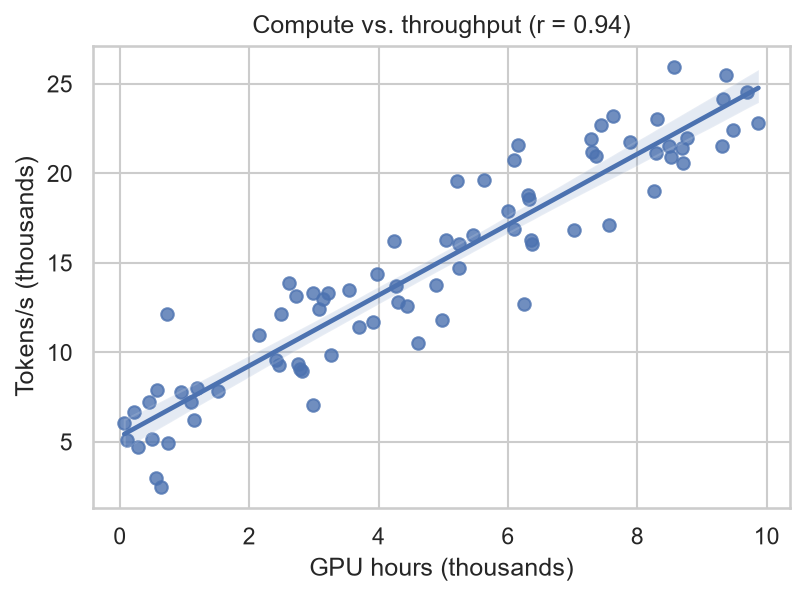

| model | judge acc / compl | facts | description |
|---|---|---|---|
| gpt-6.1-terra | 4 / 4 | 1.00 | This scatter plot shows throughput generally increasing with compute, with a reported correlation of 0.94.  The horizontal axis is GPU hours, in thousands, ranging from slightly below zero to just above 10. The vertical axis is tokens per second, in thousands, ranging from about 1 to 27; it does not start at zero. Both axes are linear.  There is no legend. Blue dots show individual observations, and a blue line with a pale shaded band shows the overall trend.  The lowest dot is at about 0.6 thousand GPU hours and 2.5 thousand tokens per second. The highest is at about 8.6 thousand GPU hours and 26 thousand tokens per second. The trend line rises from about 5 thousand tokens per second at zero GPU hours to about 25 thousand at 10 thousand GPU hours.  The relationship is strongly positive, though there is some scatter. Notable points below the trend include one at about 6.3 thousand GPU hours and 12.7 thousand tokens per second. A point at about 0.7 thousand GPU hours and 12 thousand tokens per second lies well above the trend. |
| gpt-6-luna | 4 / 5 | 1.00 | This is a single-panel scatter plot with a fitted line, showing a strong positive relationship between GPU hours and throughput.  The horizontal axis is GPU hours, in thousands, ranging from 0 to 10. The vertical axis is tokens per second, in thousands; it does not start at zero and spans roughly 1 to 27.  The plot shows blue data points and a blue upward-sloping fitted line with a pale shaded band around it.  The points range from about 0.05 thousand GPU hours and 6 thousand tokens per second to about 9.9 thousand GPU hours and 23 thousand tokens per second. The lowest throughput is about 2.5 thousand tokens per second, near 0.65 thousand GPU hours. The highest is about 26 thousand, near 8.6 thousand GPU hours. The fitted line rises from about 5.5 thousand tokens per second at zero GPU hours to about 24.5 thousand at roughly 9.8 thousand GPU hours. The title reports a correlation of 0.94.  Overall, throughput generally increases as GPU hours increase. The points cluster around the fitted line, though there is noticeable variation, including a low point near 6.2 thousand GPU hours and 12.7 thousand tokens per second. |
| gpt-6.2-astra | 5 / 5 | 0.50 | This scatter plot shows throughput rising with compute, with a reported correlation of zero point nine four.  The horizontal axis is GPU hours in thousands, labeled from zero to ten in steps of two. It extends slightly beyond those labels at both ends. The vertical axis is tokens per second in thousands, labeled from five to twenty-five in steps of five. It spans about one to twenty-seven thousand and does not start at zero. Both axes are linear.  There is one unlabeled series of blue dots, with a straight blue fitted line and a pale blue band around it. There is no legend.  The fitted line rises from about five thousand tokens per second near zero GPU hours to about twenty-five thousand tokens per second at nine thousand nine hundred GPU hours. The lowest dot is at about two thousand five hundred tokens per second and six hundred fifty GPU hours. The highest is at about twenty-six thousand tokens per second and eight thousand six hundred GPU hours.  The dots cluster around the rising line across the range. Notable departures include a dot above the line at about seven hundred fifty GPU hours and twelve thousand tokens per second, and one below it at about six thousand three hundred GPU hours and twelve thousand seven hundred tokens per second. |
| gpt-5.4-mini | 3 / 5 | 1.00 | This is a scatter plot with a fitted line that shows a strong positive relationship between GPU hours and throughput in tokens per second.  The x-axis is labeled GPU hours, in thousands, and runs from about 0 to 10. The y-axis is labeled Tokens/s, in thousands, and runs from about 2 to 27. Neither axis is logarithmic, and both start slightly above zero on the visible plot area rather than exactly at zero.  There is one series of blue circular points, plus a blue regression line with a lightly shaded confidence band. The title says Compute vs. throughput with r = 0.94.  The lowest points are around 2 to 3 thousand tokens per second at about 0.5 GPU hours. The highest point is about 26 thousand tokens per second at around 8.5 GPU hours. The fitted line starts near 5 thousand tokens per second at x equals 0 and rises to about 25 thousand at x equals 10. Around 5 GPU hours, the points are mostly between about 12 and 20 thousand tokens per second. Around 8 to 10 GPU hours, they are mostly between about 19 and 26 thousand.  The main pattern is a clear upward trend: more GPU hours correspond to higher throughput. The points are fairly tightly clustered around the line, which matches the high correlation. There are a few outliers, including one low point near 2.5 thousand tokens per second and a few points above the line around 12 to 16 thousand tokens per second at low to middle x values. |
| gemini-3.5-flash-lite | 3 / 5 | 1.00 | This is a scatter plot with a linear regression trendline showing the relationship between compute and throughput. The horizontal axis is labeled GPU hours in thousands, ranging from zero to 10. The vertical axis is labeled Tokens/s in thousands, ranging from zero to 25. There are no other series, categories, or panels in this chart. The data points show a strong positive correlation, with a correlation coefficient of 0.94, and a blue trendline representing this relationship surrounded by a shaded confidence interval. The minimum observed values are near zero on the horizontal axis and around 2.5 on the vertical axis. The maximum observed values approach 10 thousand GPU hours on the horizontal axis and about 26 thousand tokens per second on the vertical axis. Overall, as GPU hours increase, throughput increases proportionally along a clear upward linear trend, with individual data points clustered tightly around the regression line. |
| SmolVLM-256M-Instruct | nan / nan | 0.25 | Compute vs. throughput (r = 0.94) is a line chart. The y-axis measures tokens/s (thousand) while the x-axis measures CPU hours (thousands). The chart shows that the highest throughput occurs at around 1.5 million CPU hours. The lowest throughput occurs at around 1.0 million CPU hours. |

## 11_lineplot_ci_logx · line plot with confidence bands, log x-axis [hard]

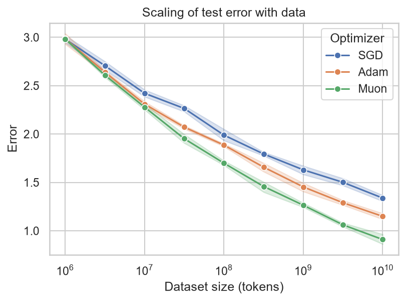

| model | judge acc / compl | facts | description |
|---|---|---|---|
| gpt-6.1-terra | 5 / 4 | 1.00 | This is a line chart showing how test error changes with dataset size for three optimizers.  The horizontal axis is dataset size in tokens, on a logarithmic scale, with labeled ticks from one million to ten billion. The vertical axis is error, with no unit shown; it runs from about 0.75 to 3.15 and does not start at zero.  The legend identifies SGD in blue, Adam in orange, and Muon in green. Each line has circular markers and a narrow shaded band around it.  At one million tokens, all three errors are about 3. At 100 million tokens, SGD is about 1.99, Adam 1.89, and Muon 1.70. At one billion tokens, they are about 1.63, 1.45, and 1.26, respectively. At ten billion tokens, their final values are about 1.34 for SGD, 1.15 for Adam, and 0.91 for Muon.  Error decreases throughout for all three optimizers. Muon is generally lowest, Adam is in the middle, and SGD is highest; the lines separate more as dataset size increases. |
| gpt-6-luna | 5 / 4 | 0.80 | This is a line chart showing how test error changes as dataset size increases for three optimizers.  There is one panel. The horizontal axis is Dataset size, in tokens, and runs from 1 million to 10 billion on a logarithmic scale. The vertical axis is Error, ranging from about 0.75 to 3.15; it does not start at zero.  The three series are SGD, Adam, and Muon.  At 1 million tokens, all three are near 3.0 error. At 10 billion tokens, SGD is about 1.34, Adam about 1.15, and Muon about 0.91. At the intermediate dataset sizes, the approximate errors for SGD are 2.70, 2.42, 2.26, 1.99, 1.79, 1.63, and 1.50. For Adam they are 2.64, 2.30, 2.07, 1.88, 1.66, 1.45, and 1.29. For Muon they are 2.60, 2.27, 1.95, 1.70, 1.45, 1.26, and 1.06.  Error decreases for all three as dataset size grows. The lines are close at the smallest size, then Muon is generally lowest, Adam is in the middle, and SGD is highest. |
| gpt-6.2-astra | 5 / 4 | 1.00 | This line chart, titled “Scaling of test error with data,” shows test error decreasing as dataset size increases for three optimizers.  The horizontal axis, labeled “Dataset size” in tokens, is logarithmic, with labeled ticks from one million to ten billion, each ten times the previous one. The vertical axis, labeled “Error,” has no stated units. It is linear and does not start at zero. It spans about 0.75 to 3.15, with labeled ticks from 1 to 3 in steps of 0.5.  The legend, titled “Optimizer,” identifies S G D in blue, Adam in orange, and Muon in green. Each line has circular markers and a narrow shaded band.  In that order, all three errors start at about 2.98 at one million tokens, their highest values. At ten million tokens, the errors are about 2.42, 2.31, and 2.27. At one hundred million, they are about 1.99, 1.88, and 1.70. At one billion, they are about 1.63, 1.45, and 1.27. At ten billion, they reach their lowest values: about 1.34, 1.15, and 0.91.  Every line falls at every step. After the nearly shared starting point, S G D consistently has the highest error, Adam is in the middle, and Muon has the lowest. The gap between S G D and Muon grows to about 0.43 by the end. |
| gpt-5.4-mini | 5 / 4 | 0.60 | This is a line chart showing how test error changes as dataset size increases for three optimizers.  The x-axis is labeled “Dataset size (tokens)” and is logarithmic, with ticks at about 10 to the 6, 10 to the 7, 10 to the 8, 10 to the 9, and 10 to the 10 tokens. The y-axis is labeled “Error” and runs from about 0.8 up to a little over 3.0; it does not start at zero. There is one panel.  The legend is titled “Optimizer” and includes three series: SGD in blue, Adam in orange, and Muon in green.  At 10 to the 6 tokens, all three start at about 3.0 error. At 3 million tokens, SGD is about 2.7, Adam about 2.65, and Muon about 2.6. At 10 million, SGD is about 2.42, Adam about 2.30, and Muon about 2.28. At 30 million, SGD is about 2.27, Adam about 2.07, and Muon about 1.95. At 100 million, SGD is about 1.98, Adam about 1.89, and Muon about 1.70. At 300 million, SGD is about 1.78, Adam about 1.66, and Muon about 1.45. At 1 billion, SGD is about 1.62, Adam about 1.45, and Muon about 1.27. At 3 billion, SGD is about 1.50, Adam about 1.28, and Muon about 1.06. At 10 billion, SGD is about 1.34, Adam about 1.15, and Muon about 0.91.  All three lines slope downward as data increases, and Muon is lowest after the smallest sizes, Adam is in the middle, and SGD is highest. The gap between them widens at larger dataset sizes. |
| gemini-3.5-flash-lite | 4 / 4 | 0.80 | This is a line chart showing the scaling of test error with data for three optimizers. The horizontal axis represents the dataset size in tokens, ranging from ten to the sixth power to ten to the tenth power on a logarithmic scale. The vertical axis represents the error, ranging from approximately zero point eight to three point two. The legend lists three optimizers: SGD in blue, Adam in orange, and Muon in green. For all three optimizers, the test error starts at about three point zero at a dataset size of ten to the sixth tokens. As the dataset size increases, the error for all optimizers decreases steadily. At the maximum dataset size of ten to the tenth tokens, the error for SGD finishes at about one point three four, Adam finishes at about one point one five, and Muon finishes at about zero point nine one. Overall, Muon consistently achieves the lowest error across all dataset sizes, followed by Adam in the middle, and SGD with the highest error. |
| SmolVLM-256M-Instruct | nan / nan | 0.00 | Scaling of test error with data. |

## 12_multi_panel_subplots · multi-panel figure (2 subplots) [hard]

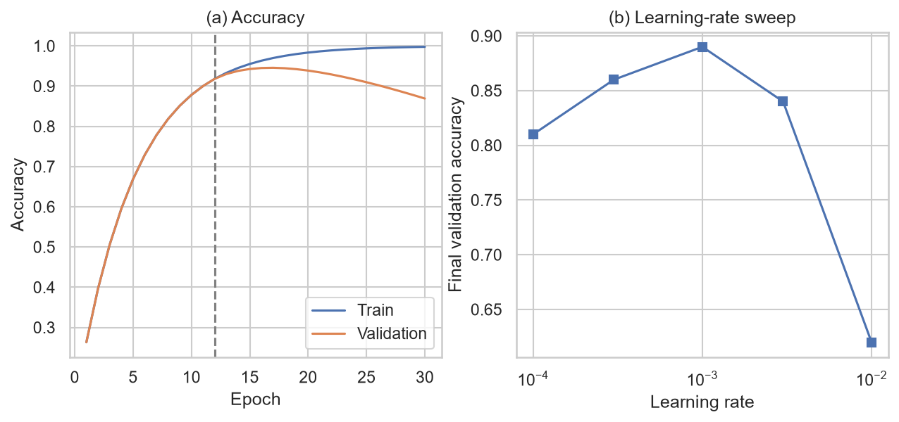

| model | judge acc / compl | facts | description |
|---|---|---|---|
| gpt-6.1-terra | 5 / 5 | 1.00 | This figure contains two line charts showing accuracy over training epochs and final validation accuracy across learning rates.  The left panel, Accuracy, plots epoch from 0 to 30 against accuracy, with labeled values from 0.3 to 1.0; the accuracy axis does not start at zero. The right panel, Learning-rate sweep, plots learning rate from 0.0001 to 0.01 on a logarithmic axis against final validation accuracy, with labeled values from 0.65 to 0.90; that accuracy axis also does not start at zero. Accuracy and learning rate have no units shown.  The left panel has blue Train and orange Validation lines, plus a dashed vertical marker at epoch 12. The right panel has one blue line with square markers and no legend.  Both left-panel lines start at about 0.26 at epoch 1 and reach about 0.92 at epoch 12. Training accuracy continues rising to about 1.00 at epoch 30. Validation accuracy peaks at about 0.95 around epoch 17, then falls to about 0.87 at epoch 30.  In the right panel, final validation accuracy is 0.81 at learning rate 0.0001, 0.86 at about 0.0003, 0.89 at 0.001, 0.84 at about 0.003, and 0.62 at 0.01.  The training and validation curves initially overlap, then diverge as validation accuracy declines. In the sweep, accuracy peaks at 0.001 and drops sharply at the highest learning rate. |
| gpt-6-luna | 5 / 4 | 0.75 | This is a two-panel line chart showing accuracy across training epochs and final validation accuracy at different learning rates.  In panel A, the horizontal axis is Epoch, from 0 to 30, and the vertical axis is Accuracy, displayed from about 0.23 to 1.03, so it does not start at zero. A dashed vertical line marks epoch 12. In panel B, the horizontal axis is Learning rate on a logarithmic scale, with values from 10 to the minus 4 through 10 to the minus 2. The vertical axis is Final validation accuracy, displayed from about 0.61 to 0.90, so it also does not start at zero.  Panel A has two series: Train and Validation. Panel B shows validation accuracy at five learning rates.  The training curve starts near 0.26 and ends near 1.00. The validation curve starts near 0.26, is about 0.91 at epoch 12, peaks near 0.95 around epoch 17, and ends near 0.87. In panel B, the values are about 0.81 at 10 to the minus 4, 0.86 at 3 times 10 to the minus 4, 0.89 at 10 to the minus 3, 0.84 at 3 times 10 to the minus 3, and 0.62 at 10 to the minus 2.  Both curves in panel A rise quickly at first; training continues upward while validation declines after its peak. In panel B, accuracy peaks at the middle learning rate and drops sharply at the highest one. |
| gpt-6.2-astra | 5 / 5 | 1.00 | This two-panel line chart shows how training and validation accuracy change with epoch, and how final validation accuracy varies with learning rate.  In the left panel, A, titled Accuracy, the horizontal axis is Epoch, labeled from zero to 30 in steps of five. The vertical axis is Accuracy, with labels from 0.3 to 1 in steps of 0.1. Both axes are linear, and the vertical axis does not start at zero. In the right panel, B, titled Learning-rate sweep, the horizontal axis is Learning rate, on a logarithmic scale labeled 0.0001, 0.001, and 0.01. The vertical axis is Final validation accuracy, with a linear scale starting just above 0.6 and labeled from 0.65 to 0.90.  Panel A labels the blue line Train and the orange line Validation. Panel B has one blue line with square markers.  Both curves start at about 0.26 at epoch one and reach about 0.92 at epoch 12, marked by a dashed vertical line. Training accuracy approaches 1 by epoch 30. Validation accuracy peaks at about 0.945 near epoch 17 and ends at about 0.87. In panel B, at learning rates of 0.0001, 0.0003, 0.001, 0.003, and 0.01, the accuracies are about 0.81, 0.86, 0.89, 0.84, and 0.62, respectively.  The epoch curves initially overlap, then diverge as training accuracy levels off and validation accuracy declines. The sweep peaks at the middle rate and drops most sharply at the highest rate. |
| gpt-5.4-mini | 5 / 4 | 0.75 | This is a two-panel line chart showing model accuracy over epochs and a learning-rate sweep of final validation accuracy.  The left panel, labeled “(a) Accuracy,” has Epoch on the x-axis from 0 to 30 and Accuracy on the y-axis from about 0.25 to 1.0; it is not logarithmic. The right panel, labeled “(b) Learning-rate sweep,” has Learning rate on the x-axis on a logarithmic scale from 10 to the minus 4 to 10 to the minus 2, and Final validation accuracy on the y-axis from about 0.62 to 0.90.  The legend in the left panel has two series: Train in blue and Validation in orange. The right panel has one blue series with square markers and no separate legend.  In the accuracy panel, training accuracy starts at about 0.27 and rises to about 0.91 by epoch 12, then climbs to about 0.995 by epoch 30. Validation accuracy starts at about 0.27, reaches about 0.91 at epoch 12, peaks around 0.94 to 0.95 near epochs 16 to 18, and ends around 0.87 at epoch 30.  In the learning-rate panel, the points are about 0.81 at 10 to the minus 4, 0.86 at 3 times 10 to the minus 4, 0.888 at 10 to the minus 3, 0.84 at 3 times 10 to the minus 3, and 0.62 at 10 to the minus 2.  The main pattern is that training keeps improving steadily, while validation improves then slightly declines, suggesting overfitting after the middle epochs. In the sweep, performance peaks near 10 to the minus 3 and drops sharply at the largest learning rate. |
| gemini-3.5-flash-lite | 3 / 4 | 0.00 | This figure contains two line charts placed side by side, labeled (a) and (b), showing machine learning model performance.   Chart (a) displays Accuracy on the vertical axis, ranging from about zero-point-two to one-point-zero, plotted against Epoch on the horizontal axis, which runs from zero to thirty. Chart (b) shows Final validation accuracy on the vertical axis, ranging from zero-point-six to zero-point-nine, plotted against Learning rate on the horizontal axis, which uses a logarithmic scale from ten to the negative fourth power to ten to the negative second power.   Chart (a) includes a legend with two series: Train in blue and Validation in orange. A vertical dashed gray line marks epoch twelve. Chart (b) shows a single blue line with square markers at five data points corresponding to different learning rates.  In chart (a), both the train and validation accuracy start at about zero-point-two-six at epoch one and rise together. Around epoch twelve, where the dashed line is placed, the validation curve peaks at about zero-point-nine-two and then slowly decreases to about zero-point-eight-seven by epoch thirty. Meanwhile, the training accuracy continues to rise, approaching one-point-zero by epoch thirty. In chart (b), the final validation accuracy starts at zero-point-eight-one at a learning rate of ten to the negative fourth power, increases to a peak of zero-point-eight-nine at ten to the negative third power, and then drops sharply to zero-point-six-two at ten to the negative second power. |
| SmolVLM-256M-Instruct | nan / nan | 0.00 | A line chart showing the accuracy of final validation in a learning-rate sweep over epochs. The x-axis represents the learning rate, ranging from 0 to 10^4. The y-axis measures the accuracy, ranging from 0.0 to 0.95. The line starts at a low point and then increases to a high point, indicating a significant improvement in the accuracy over the epochs. |

## 13_facetgrid_relplot · faceted line plots (small multiples) [hard]

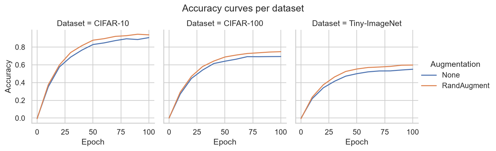

| model | judge acc / compl | facts | description |
|---|---|---|---|
| gpt-6.1-terra | 4 / 4 | 1.00 | This is a three-panel line chart showing accuracy over training epochs for three datasets, with and without augmentation.  Each panel has a horizontal axis labeled Epoch, with ticks from 0 to 100, and a vertical axis labeled Accuracy, with ticks from 0 to 0.8. The plotted accuracy range extends slightly below zero to about 1. Both axes are linear.  From left to right, the panels are CIFAR-10, CIFAR-100, and Tiny-ImageNet. In each panel, the blue line is None and the orange line is RandAugment.  All lines start at approximately zero. For CIFAR-10, at epoch 50, accuracy is about 0.83 without augmentation and 0.88 with RandAugment. At epoch 100, the values are about 0.91 and 0.94. RandAugment peaks at about 0.95 around epoch 90.  For CIFAR-100, the values at epoch 50 are about 0.64 and 0.69, rising to about 0.69 and 0.75 at epoch 100.  For Tiny-ImageNet, the values at epoch 50 are about 0.50 and 0.55, rising to about 0.55 and 0.60 at epoch 100.  Accuracy rises quickly at first and then levels off in all three panels. RandAugment stays above no augmentation after the start. CIFAR-10 has the highest accuracy, followed by CIFAR-100, then Tiny-ImageNet. |
| gpt-6-luna | 5 / 5 | 1.00 | This is a three-panel line chart showing accuracy over training epochs for three datasets, with and without RandAugment.  Each panel has Epoch on the horizontal axis, from 0 to 100, and Accuracy on the vertical axis, with labeled ticks from 0.0 to 0.8; the plotted range extends to about 1.0. Neither axis is logarithmic. The panels, from left to right, are CIFAR-10, CIFAR-100, and Tiny-ImageNet.  The two series in every panel are None, shown in blue, and RandAugment, shown in orange.  All lines start at zero. At epoch 100, CIFAR-10 is about 0.91 for None and 0.94 for RandAugment. CIFAR-100 is about 0.69 and 0.75, respectively. Tiny-ImageNet is about 0.55 and 0.60. The highest endpoint is RandAugment on CIFAR-10; the lowest is None on Tiny-ImageNet.  Accuracy rises quickly in the early epochs, then gains slow. RandAugment is consistently slightly higher than None after the start, and both methods rank the datasets in the same order: CIFAR-10 highest, CIFAR-100 next, and Tiny-ImageNet lowest. |
| gpt-6.2-astra | 5 / 5 | 1.00 | This three-panel line chart shows how accuracy changes over training epochs for two augmentation settings on each dataset.  All three panels use the same linear scales. The horizontal axis, labeled Epoch, has ticks from zero to 100 in steps of 25. The vertical axis, labeled Accuracy, shows accuracy as a fraction, with ticks from zero to 0.8 in steps of 0.2. The plotting area extends slightly below zero and up to about 1.  From left to right, the panels are CIFAR-10, CIFAR-100, and Tiny-ImageNet. The legend is titled Augmentation. Blue means None, and orange means RandAugment.  All six curves start at about zero. On CIFAR-10, accuracy at epoch 50 is about 0.83 without augmentation and 0.88 with RandAugment. At epoch 100, the values are about 0.91 and 0.94, respectively. RandAugment peaks at about 0.95 near epoch 90. On CIFAR-100, the values in the same order are about 0.64 and 0.69 at epoch 50, ending at about 0.69 and 0.75. On Tiny-ImageNet, they are about 0.50 and 0.55 at epoch 50, ending at about 0.55 and 0.60.  Accuracy rises fastest early and then levels off. RandAugment stays above no augmentation after the start. For both settings, CIFAR-10 finishes highest, followed by CIFAR-100, then Tiny-ImageNet. |
| gpt-5.4-mini | 3 / 4 | 1.00 | This is a three-panel line chart showing accuracy over training epochs for three datasets, comparing two augmentation settings.  The x-axis in each panel is Epoch, from 0 to 100. The y-axis is Accuracy, shown from about 0 to 0.9, and it does not start at zero because the lower edge is slightly below 0. There are three panels: CIFAR-10 on the left, CIFAR-100 in the middle, and Tiny-ImageNet on the right.  The legend on the right is titled Augmentation, with two series: None in blue and RandAugment in orange.  For CIFAR-10, both lines start at 0.0, rise to about 0.58 at 20 epochs, about 0.74 to 0.76 at 30, about 0.85 to 0.87 at 50, and end around 0.90 for None and about 0.93 for RandAugment at 100. For CIFAR-100, they start at 0.0, reach about 0.45 to 0.47 at 20, about 0.61 to 0.64 at 40, and end around 0.69 for None and 0.74 for RandAugment. For Tiny-ImageNet, they start at 0.0, reach about 0.35 to 0.38 at 20, about 0.47 to 0.53 at 40, and end around 0.55 for None and 0.60 for RandAugment.  The main pattern is that accuracy rises quickly early, then levels off. RandAugment is consistently above None in all three panels, with the biggest gap on Tiny-ImageNet and the smallest gap on CIFAR-10. |
| gemini-3.5-flash-lite | 4 / 5 | 0.50 | This figure consists of three line charts arranged side by side, showing accuracy curves per dataset over one hundred epochs. Each of the three panels plots accuracy on the vertical axis, ranging from zero to point eight, against epoch on the horizontal axis, ranging from zero to one hundred with grid lines every twenty-five epochs. The panels represent three different datasets: left is CIFAR-ten, middle is CIFAR-one hundred, and right is Tiny-ImageNet. The legend on the far right defines two augmentation methods: None is shown in blue, and RandAugment is shown in orange. Across all three datasets, both lines start at zero accuracy at epoch zero and increase rapidly before leveling off around epoch fifty to one hundred. For CIFAR-ten, the blue line representing no augmentation reaches a final accuracy of about zero point nine, while the orange line for RandAugment reaches about zero point nine four. For CIFAR-one hundred, the blue line ends around zero point six nine and the orange line ends near zero point seven five. For Tiny-ImageNet, the final accuracy is lower, with the blue line finishing at about zero point five five and the orange line at about zero point six. In every dataset, the orange line for RandAugment consistently achieves higher accuracy than the blue line after the first few epochs. |
| SmolVLM-256M-Instruct | nan / nan | 0.00 | Accuracy curves per dataset. |

## 14_pointplot_ablation · point plot with error bars [medium]

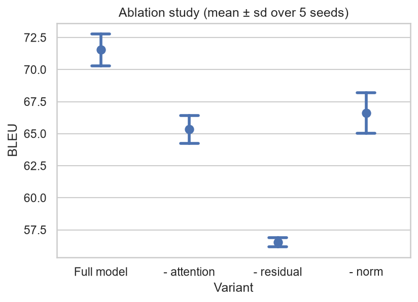

| model | judge acc / compl | facts | description |
|---|---|---|---|
| gpt-6.1-terra | 5 / 5 | 1.00 | This is an error-bar chart showing mean BLEU scores for four model variants, with standard deviations over five seeds.  There is one panel. The horizontal axis, labeled Variant, lists the four variants. The vertical axis, labeled BLEU, runs from about 55.3 to 73.6, with labeled ticks from 57.5 to 72.5. It is linear and does not start at zero.  The groups are Full model, minus attention, minus residual, and minus norm.  The full model scores about 71.5, with an error range from 70.3 to 72.8. Minus attention scores about 65.3, ranging from 64.2 to 66.4. Minus residual scores about 56.6, ranging from 56.2 to 56.9. Minus norm scores about 66.6, ranging from 65.0 to 68.2.  The full model has the highest score. Minus norm ranks second, followed by minus attention, while minus residual is much lower than all the others. |
| gpt-6-luna | 5 / 5 | 1.00 | This is an error-bar chart showing mean BLEU scores for four model variants, with standard deviations over five seeds.  The horizontal axis is labeled Variant and has four categories. The vertical axis is labeled BLEU; it has no units, uses a linear scale, and does not start at zero. The visible scale runs from about 55 to 74, with labeled ticks from 57.5 to 72.5 in steps of 2.5.  The categories are Full model, minus attention, minus residual, and minus norm. There is no separate legend.  The mean scores are about 71.5 for Full model, 65.3 for minus attention, 56.5 for minus residual, and 66.6 for minus norm. The error bars span about 70.3 to 72.8, 64.2 to 66.4, 56.2 to 56.9, and 65.0 to 68.2, respectively.  The Full model has the highest mean, and minus residual has the lowest by a wide margin. Minus norm scores about 1.3 points higher than minus attention. The residual variant also has the smallest error bar, while minus norm has the largest. |
| gpt-6.2-astra | 5 / 5 | 1.00 | This single-panel dot-and-error-bar chart shows mean BLEU scores for four model variants in an ablation study, with error bars extending one standard deviation above and below each mean over five seeds.  The horizontal axis, labeled Variant, is categorical. The vertical axis, labeled BLEU, is linear and does not start at zero. It spans about 55.3 to 73.6 BLEU points, with labeled ticks from 57.5 to 72.5 in steps of 2.5.  From left to right, the categories are Full model, minus attention, minus residual, and minus norm. Each blue dot marks a mean.  The full model averages about 71.5, with an error bar from about 70.3 to 72.8. Minus attention averages about 65.3, spanning about 64.2 to 66.4. Minus residual averages about 56.5, spanning about 56.2 to 56.9. Minus norm averages about 66.6, spanning about 65.0 to 68.2.  The full model scores highest. Minus norm ranks second, slightly above minus attention, and their error bars overlap. Minus residual is lowest by a wide margin, about 15 BLEU points below the full model, and has the shortest error bar. |
| gpt-5.4-mini | 5 / 5 | 1.00 | This is a dot-and-error-bar chart showing the mean BLEU score with standard deviation over 5 seeds for four model variants.  The x-axis is labeled Variant and has four categories: Full model, minus attention, minus residual, and minus norm. The y-axis is labeled BLEU, with values shown from about 56 to about 73. The axis is linear and does not start at zero.  There is one panel and four groups, one for each variant.  The Full model is at about 71.5 BLEU, with error bars from about 70.3 to 72.8. Minus attention is about 65.3, with error bars from about 64.3 to 66.4. Minus residual is about 56.6, with very small error bars from about 56.3 to 56.9. Minus norm is about 66.6, with error bars from about 65.0 to 68.2.  The main pattern is that the Full model is highest. Removing residual hurts performance the most and is by far the lowest. Removing attention also lowers BLEU a lot, while removing norm lowers it less than removing attention but still clearly below the full model. |
| gemini-3.5-flash-lite | 4 / 5 | 1.00 | This is a dot plot with error bars showing an ablation study over five seeds, displaying BLEU performance across four model variants. The vertical axis represents BLEU, with values ranging from 57.5 to 72.5, and it does not start at zero. The horizontal axis represents the Variant, categorized into Full model, minus attention, minus residual, and minus norm. There is no legend. The key values for the mean BLEU score and standard deviation error bars are as follows. The Full model achieves the highest performance at about 71.5 BLEU, with error bars spanning from about 70.2 to 72.8. The minus attention variant drops to a mean of about 65.3 BLEU, with error bars from about 64.2 to 66.4. The minus residual variant performs the worst, plummeting to a mean of about 56.5 BLEU, with very narrow error bars from about 56.2 to 56.9. Finally, the minus norm variant recovers to a mean of about 66.6 BLEU, with error bars spanning from about 65.0 to 68.2. Overall, the full model achieves the best results, while removing the residual connections causes the most catastrophic performance drop, indicating that all components contribute to the model's performance, especially the residual connections. |

## 15_pairplot · pair plot (scatter-plot matrix) [hard]

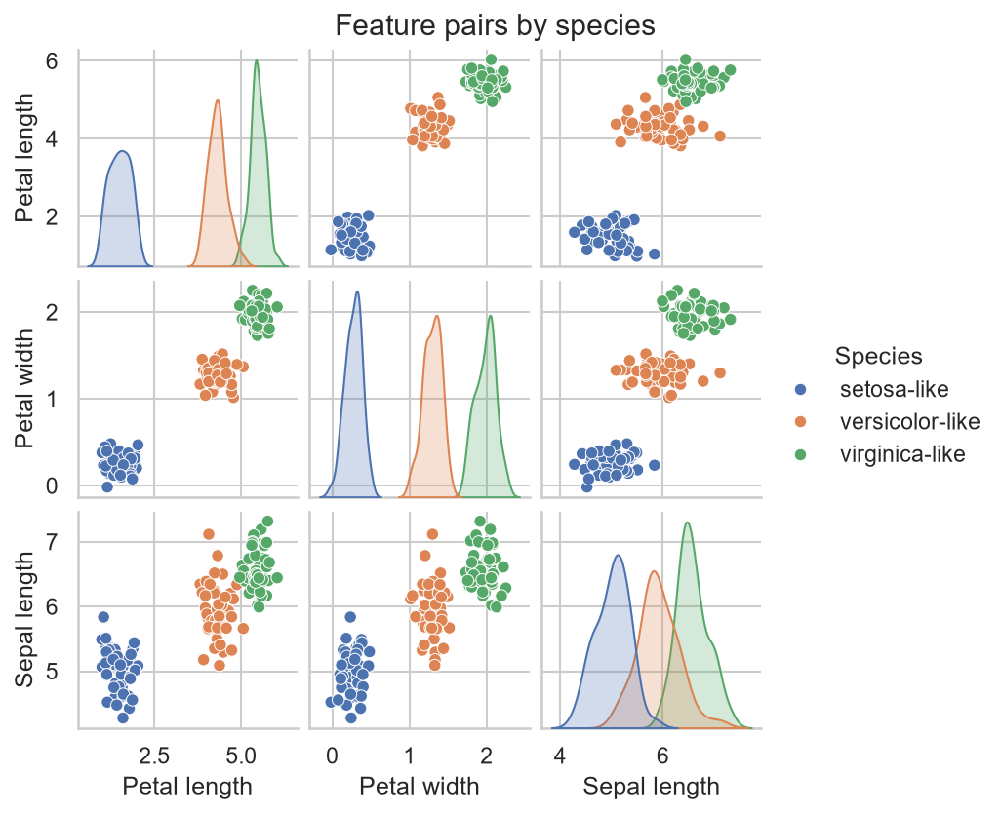

| model | judge acc / compl | facts | description |
|---|---|---|---|
| gpt-6.1-terra | 5 / 5 | 1.00 | This is a nine-panel scatterplot matrix titled “Feature pairs by species,” showing relationships and distributions for three flower measurements.  The columns, from left to right, show petal length, petal width, and sepal length on the horizontal axes. The rows show the same measurements, in the same order, on the vertical axes. The diagonal panels show distributions instead of scatterplots. The top row contains petal length’s distribution and its comparisons with petal width and sepal length; the middle row contains petal width’s comparisons and distribution; and the bottom row does the same for sepal length. Units are not specified. All measurement axes are linear and extend beyond the data rather than starting at zero. Across the panels, petal length spans roughly 0.3 to 6.6, petal width roughly minus 0.3 to 2.6, and sepal length roughly 3.6 to 7.9. The diagonal density scales are not labeled.  The groups are setosa-like in blue, versicolor-like in orange, and virginica-like in green.  The distribution peaks are about 1.5, 4.3, and 5.5 for petal length; about 0.3, 1.4, and 2.0 for petal width; and about 5.1, 5.9, and 6.5 for sepal length, in the same group order. The observed points range approximately from 1 to 6 in petal length, zero to 2.3 in petal width, and 4.3 to 7.3 in sepal length.  The groups form distinct clusters for petal measurements, with setosa-like smallest and virginica-like largest. Sepal lengths overlap more. Petal length and width rise together strongly. |
| gpt-6-luna | 3 / 4 | 1.00 | This is a three-by-three scatterplot matrix showing petal and sepal measurements for three species groups, with each variable’s distribution shown along the diagonal.  The horizontal axes, from left to right, are petal length, petal width, and sepal length; the vertical axes, from top to bottom, are the same three measurements. No measurement units are given. The scales are linear. Petal length runs from near zero to about seven, petal width from near zero to about two point four, and sepal length from about four to eight. So the sepal-length axes do not start at zero. The diagonal panels show distributions rather than scatter points.  The legend names the blue setosa-like group, the orange versicolor-like group, and the green virginica-like group.  Setosa-like measurements cluster around petal lengths of one to two, petal widths of about zero point one to zero point five, and sepal lengths of about four point three to five point eight. Versicolor-like points cluster around petal lengths of four to five, widths of about one to one point eight, and sepal lengths of about five to seven point one. Virginica-like points cluster around petal lengths of five to seven, widths of about one point four to two point three, and sepal lengths of about six to seven point three.  Overall, setosa-like points are clearly separated at smaller petal measurements. Versicolor-like and virginica-like points have larger measurements and overlap more, though virginica-like points generally have larger petals and sepals. The orange sepal-length maximum near seven point one is a visible high point. |
| gpt-6.2-astra | 4 / 4 | 1.00 | This nine-panel scatterplot matrix, titled Feature pairs by species, shows how three flower measurements vary together across three species groups.  The axes are linear, with no units shown. From left to right, the horizontal axes are petal length, spanning about 0.3 to 6.6, petal width, about minus 0.3 to 2.6, and sepal length, about 3.6 to 7.9. From top to bottom, the vertical axes follow the same order and ranges in the scatterplots. Only the petal width range includes zero. In the top row, petal length is shown first as distribution curves, then against petal width and sepal length. The middle row shows petal width against petal length, then width distributions, then petal width against sepal length. The bottom row shows sepal length against petal length and petal width, then sepal length distributions. Curve heights have no separately labeled scale.  The species legend identifies blue as setosa-like, orange as versicolor-like, and green as virginica-like.  In that species order, petal length distributions peak at about 1.6, 4.3, and 5.5. Petal width peaks are about 0.3, 1.4, and 2.0. Sepal length peaks are about 5.1, 5.8, and 6.5.  The groups cluster from blue at the lowest values to green at the highest for all three measurements. Petal length and width together separate the clusters clearly. Sepal lengths overlap more, particularly between orange and green; the highest orange point reaches about 7.1. |
| gpt-5.4-mini | 4 / 4 | 0.67 | This is a scatterplot matrix with smooth density curves on the diagonal, showing how petal length, petal width, and sepal length vary by species group.  The matrix has three variables on both axes: petal length, petal width, and sepal length. The x and y axes are in plain numeric units, not logarithmic, and they do not all start at zero. Petal length is shown roughly from about 1.0 to 6.5, petal width from about 0.0 to 2.5, and sepal length from about 4.0 to 7.5. There are nine panels total, one for each pairwise combination, with the three diagonal panels showing distributions for each variable.  The legend has three groups: setosa-like in blue, versicolor-like in orange, and virginica-like in green.  The blue group is around petal length 1 to 2, petal width 0 to 0.5, and sepal length about 4.3 to 5.8. The orange group is around petal length 3.8 to 5.0, petal width about 1.0 to 1.5, and sepal length about 5.0 to 7.1. The green group is around petal length 4.7 to 6.3, petal width about 1.6 to 2.3, and sepal length about 6.0 to 7.4.  The main pattern is clear separation by species, especially in petal length and petal width. Blue points are lowest, orange are in the middle, and green are highest. Sepal length overlaps more, but green is generally longest, blue shortest, and orange in between. |
| gemini-3.5-flash-lite | 3 / 4 | 0.67 | This is a pair plot showing three features, petal length, petal width, and sepal length, grouped by three species categories. The figure is arranged as a three-by-three grid of panels. The diagonal panels show kernel density estimate distributions for each feature, while the off-diagonal panels are scatter plots displaying relationships between pairs of features. The horizontal and vertical axes correspond to the three features: petal length ranges from about one to seven, petal width ranges from zero to two point five, and sepal length ranges from four to eight. The legend on the right lists three species: setosa-like in blue, versicolor-like in orange, and virginica-like in green. In the diagonal panels, setosa-like has the lowest petal length and width values with peaks around one point five and zero point three, while virginica-like has the highest values with peaks around five point five and two. In the scatter plots, the data points clearly separate into three distinct clusters corresponding to the three species. The blue setosa-like points form a tight, isolated cluster on the lower end for petal length and width, whereas the orange versicolor-like and green virginica-like clusters are close to each other in sepal length but separate clearly along the petal length and petal width axes. |

## 16_clustermap · clustered heatmap with dendrograms [hard]

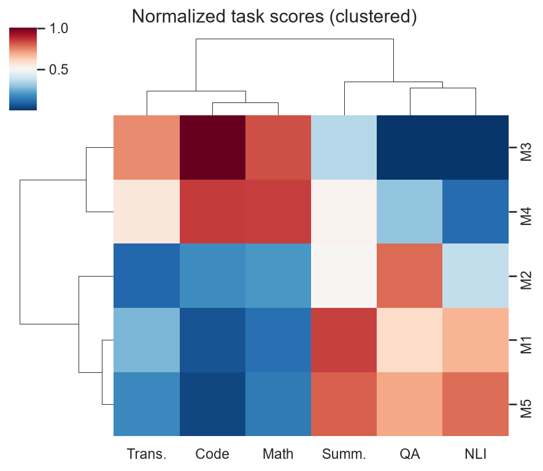

| model | judge acc / compl | facts | description |
|---|---|---|---|
| gpt-6.1-terra | 5 / 4 | 1.00 | This is a clustered heat map showing normalized task scores for five models across six tasks.  The horizontal axis lists tasks, and the vertical axis lists models; neither axis has units or a numerical range. The color scale runs from about 0 in dark blue to 1 in dark red, with ticks labeled 0.5 and 1. Dendrograms above and to the left show the clustering, without labeled distance scales.  From left to right, the tasks are Trans., Code, Math, Summ., QA, and NLI. From top to bottom, the models are M3, M4, M2, M1, and M5.  In task order, M3 scores about 0.73, 1.00, 0.82, 0.36, 0.01, and 0.01. M4 scores about 0.55, 0.84, 0.84, 0.52, 0.30, and 0.12. M2 scores about 0.11, 0.21, 0.22, 0.50, 0.78, and 0.37. M1 scores about 0.28, 0.08, 0.13, 0.84, 0.59, and 0.66. M5 scores about 0.19, 0.05, 0.15, 0.80, 0.68, and 0.78.  The highest score is M3 on Code, while its QA and NLI scores are near zero. M3 and M4 cluster together, as do M1 and M5. Code and Math cluster together, as do QA and NLI. M3 and M4 score relatively highly on Code and Math, whereas M1 and M5 score relatively highly on Summ., QA, and NLI. |
| gpt-6-luna | 3 / 4 | 1.00 | This is a clustered heat map showing normalized scores for five methods across six task categories.  There is one panel. The horizontal axis lists task categories and the vertical axis lists methods; both are categorical, with no units or numeric range. The color scale runs from about zero at dark blue to one at dark red, with a midpoint at 0.5; it is not logarithmic. Dendrograms show clustering along the top and left sides.  The methods are M3, M4, M2, M1, and M5. The task categories are Trans., Code, Math, Summ., QA, and NLI.  Approximate scores by method, in that task order, are: M3, 0.75, 1.0, 0.85, 0.4, 0.05, and 0.05; M4, 0.55, 0.9, 0.9, 0.5, 0.35, and 0.15; M2, 0.15, 0.25, 0.25, 0.5, 0.8, and 0.4; M1, 0.35, 0.1, 0.15, 0.9, 0.6, and 0.7; M5, 0.25, 0.05, 0.2, 0.85, 0.7, and 0.8.  M3 has the highest score, about 1.0 on Code, while M5 is lowest there at about 0.05. M3 and M4 are strongest on Code and Math, while M1 and M5 are stronger on Summ., QA, and NLI. Trans. and Math scores are relatively low for M2, M1, and M5. |
| gpt-6.2-astra | 5 / 5 | 0.67 | This clustered heat map shows normalized task scores for five rows across six tasks, with branching trees showing how the rows and columns group together.  There is one panel. The horizontal axis lists tasks, and the vertical axis lists M labels. Both axes are categorical. The color key marks zero point five near white and one at dark red. Darker blue indicates lower scores; the blue endpoint is unlabeled.  From left to right, the columns are Trans, Code, Math, Summ, Q A, and N L I. From top to bottom, the rows are M three, M four, M two, M one, and M five.  In column order, approximate scores read from color are as follows. M three: about point seven, one, point eight, point four, near zero, and near zero. M four: about point six, point eight, point eight, point five, point three, and point one. M two: about point one, point two, point two, point five, point eight, and point four. M one: about point three, point one, point one, point eight, point six, and point seven. M five: about point two, near zero, point one, point eight, point seven, and point eight.  The trees group the first three tasks separately from the last three. M three and M four cluster together and score higher on the first three tasks. M one and M five pair closely and show the reverse pattern. M two joins that pair but peaks on Q A. |
| gpt-5.4-mini | 2 / 3 | 1.00 | This is a clustered heatmap showing normalized task scores for five methods across six tasks, with dendrograms clustering both the rows and the columns.  The x-axis lists the tasks Trans., Code, Math, Summ., QA, and NLI, with no units shown. The y-axis lists the methods M3, M4, M2, M1, and M5. The color scale at upper left runs from 0.5 to 1.0, with blue for lower values and red for higher values. There is one main panel.  The row groups are M3, M4, M2, M1, and M5. The column groups are Trans., Code, Math, Summ., QA, and NLI.  The highest visible values are around 1.0 for M3 on Code and about 0.9 for M3 on Math. M3 is also about 0.8 on Trans. and about 0.7 on Summ., but about 0.5 on QA and NLI. M4 is about 0.6 on Trans., about 0.85 on Code and Math, about 0.55 on Summ., about 0.45 on QA, and about 0.3 on NLI. M2 is about 0.3 on Trans., about 0.35 to 0.4 on Code and Math, about 0.55 on Summ., about 0.75 on QA, and about 0.45 on NLI. M1 is about 0.4 on Trans., about 0.25 on Code, about 0.3 on Math, about 0.85 on Summ., about 0.65 on QA, and about 0.7 on NLI. M5 is about 0.35 on Trans., about 0.2 on Code, about 0.3 on Math, about 0.75 on Summ., about 0.7 on QA, and about 0.75 on NLI.  The main pattern is that M3 and M4 cluster together and score best on Code and Math, while M1 and M5 cluster together and score best on Summ., QA, and NLI. M2 sits between these groups, doing relatively better on QA. Trans. is moderate for M3 and M4, but lower for the others. |
| gemini-3.5-flash-lite | 3 / 4 | 1.00 | This image is a clustered heatmap titled Normalized task scores clustered, which visualizes the performance of five different models across six tasks. The vertical axis lists the models labeled M3, M4, M2, M1, and M5. The horizontal axis lists the tasks labeled Trans., Code, Math, Summ., QA, and NLI. A colorbar in the top left corner serves as a legend, ranging from dark blue at zero point five to dark red at one point zero, representing normalized task scores.   Hierarchical clustering dendrograms are shown along the top and left sides, grouping similar tasks and models together. The tasks split into two main clusters: the first includes Translation, Code, and Math, while the second includes Summarization, QA, and NLI. The models also split into two main clusters: M3 and M4 in one group, and M2, M1, and M5 in another.   Models M3 and M4 achieve their highest scores in the Code and Math tasks, shown in dark red and reddish tones with values near one point zero, while scoring poorly in QA and NLI, shown in dark blue. Conversely, models M1, M2, and M5 perform best on Summarization, QA, and NLI, with scores in the orange to red range, but show lower performance on Translation, Code, and Math, represented by blue shades. Model M3 achieves the absolute highest score for Code, shown in the darkest red, and the lowest score for NLI, shown in the darkest blue. |

## 17_ecdf · ECDF plot [hard]

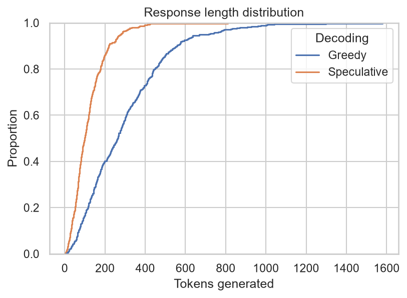

| model | judge acc / compl | facts | description |
|---|---|---|---|
| gpt-6.1-terra | 5 / 4 | 0.67 | This line chart shows the distribution of response lengths for two decoding methods.  The horizontal axis is labeled Tokens generated, with ticks from zero to 1,600; the plotted range extends slightly below zero. The vertical axis is labeled Proportion and runs from zero to one. Both axes are linear.  The legend identifies Greedy in blue and Speculative in orange.  Both curves start near zero tokens and a proportion of zero. At 100 tokens, Greedy is at about 0.16 and Speculative at about 0.5. At 200 tokens, they are at about 0.4 and 0.86, respectively. At 400 tokens, Greedy is at about 0.73 and Speculative is close to 1. Speculative reaches 1 at about 450 tokens. Greedy reaches about 0.92 at 600 tokens and approaches 1 between about 1,200 and 1,600 tokens.  The Speculative curve rises much more steeply and remains above the Greedy curve until both approach 1, showing that its responses are generally shorter. |
| gpt-6-luna | 3 / 4 | 1.00 | This is a single-panel cumulative distribution chart showing the proportion of responses at or below different generated lengths for two decoding methods.  The horizontal axis is labeled “Tokens generated” and runs from zero to about 1,650 tokens, with ticks every 200; it is linear. The vertical axis is labeled “Proportion” and runs from zero to 1.0 in steps of 0.2; it is also linear and starts at zero.  The legend names two lines: Greedy in blue and Speculative in orange.  Speculative reaches a proportion of about 0.5 at 100 tokens, 0.8 at 180, and 0.9 at 230, then approaches 1.0 by about 400 tokens. Greedy reaches about 0.2 at 130 tokens, 0.4 at 200, 0.6 at 300, 0.8 at 440, and 0.9 at 550. It approaches 1.0 around 1,000 tokens.  Both lines start near zero. The orange Speculative line rises faster and stays to the left of the blue Greedy line, indicating shorter response lengths overall. Greedy has a longer tail, extending to roughly 1,000 tokens, while Speculative levels off by roughly 400 tokens. |
| gpt-6.2-astra | 5 / 5 | 1.00 | This cumulative line chart, titled “Response length distribution,” compares the proportions of responses at or below a given length for two decoding methods.  The horizontal axis, labeled “Tokens generated,” has ticks from zero to 1,600 in steps of 200, with a small margin beyond each end. The vertical axis, labeled “Proportion,” runs from zero to one in steps of zero point two. Both scales are linear.  The legend, titled “Decoding,” identifies Greedy in blue and Speculative in orange.  Both curves start near zero tokens at a proportion of zero. The halfway point is about 100 tokens for Speculative and about 260 for Greedy. At 200 tokens, about 86 percent of Speculative responses and about 40 percent of Greedy responses are at or below that length. At 400 tokens, the proportions are about 99 percent and 73 percent, respectively. The orange curve reaches one at about 450 tokens. The blue curve reaches about 99 percent by 1,000 tokens and extends along the top of the chart to about 1,580 tokens.  The orange curve rises more steeply and levels off earlier. Speculative responses are generally shorter, while Greedy has a longer tail. |
| gpt-5.4-mini | 4 / 4 | 1.00 | This is a two-line cumulative distribution chart showing the proportion of responses at or below each response length for two decoding methods.  The x-axis is labeled Tokens generated, ranging from about 0 to 1600, and it is linear. The y-axis is labeled Proportion, ranging from 0 to 1.0, and it is linear; it does not start below zero. There is one panel.  The legend is titled Decoding and has two series: Greedy in blue and Speculative in orange.  For Speculative, the curve rises very quickly: it is about 0.2 at 50 tokens, about 0.5 at 100, about 0.8 at 175 to 200, about 0.95 at 300, and reaches about 1.0 by around 450 tokens. For Greedy, it is about 0.1 at 50 tokens, about 0.2 at 100, about 0.4 at 200, about 0.6 at 300, about 0.75 at 400, about 0.9 at 550, about 0.95 at 650, and approaches 1.0 only near 1000 tokens and above.  The main pattern is that Speculative responses are consistently shorter than Greedy responses: its curve is much farther left, meaning a given proportion is reached at far fewer tokens. Greedy has a much longer tail, extending out to around 1600 tokens, while Speculative is nearly saturated by about 450 tokens. |
| gemini-3.5-flash-lite | 4 / 5 | 1.00 | This is a cumulative distribution function plot showing response length distribution for two decoding methods. The horizontal axis is labeled Tokens generated, with a linear scale ranging from zero to sixteen hundred. The vertical axis is labeled Proportion, ranging from zero point zero to one point zero. The legend displays two decoding methods, Greedy in blue and Speculative in orange. Looking at the key values and patterns, the orange line for Speculative decoding rises much faster than the blue line for Greedy decoding, indicating that Speculative generates shorter responses overall. The orange line starts near zero tokens at zero proportion, reaches a proportion of about zero point five at around one hundred tokens, and nearly reaches one point zero at about four hundred tokens, with its absolute maximum ending around eight hundred tokens. In contrast, the blue line for Greedy decoding starts near zero tokens, reaches a proportion of zero point five around two hundred fifty tokens, and reaches one point zero around sixteen hundred tokens, showing a much wider spread and longer maximum response lengths compared to the speculative method. |

## 18_countplot_horizontal · horizontal bar chart (counts) [easy]

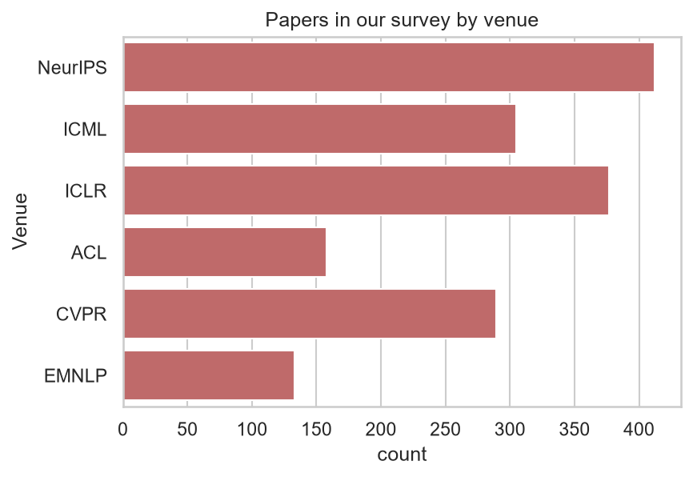

| model | judge acc / compl | facts | description |
|---|---|---|---|
| gpt-6.1-terra | 5 / 5 | 1.00 | This horizontal bar chart shows the number of papers in the survey by venue.  The horizontal axis is labeled “count” and runs from zero to about 430 papers, with labeled ticks every 50 up to 400. It is linear. The vertical axis is labeled “Venue.”  There is no legend. From top to bottom, the venues are NeurIPS, ICML, ICLR, ACL, CVPR, and EMNLP.  The counts are about 411 for NeurIPS, 304 for ICML, 376 for ICLR, 157 for ACL, 288 for CVPR, and 132 for EMNLP.  NeurIPS has the most papers, followed by ICLR. ICML and CVPR are close together, while ACL and EMNLP have substantially fewer papers. EMNLP has the fewest. |
| gpt-6-luna | 5 / 5 | 1.00 | This is a horizontal bar chart showing the number of papers in the survey for six venues.  The horizontal axis is labeled “count,” runs from zero to about 430, and has ticks every 50; it is linear and starts at zero. The vertical axis is labeled “Venue” and lists the categories.  There is no separate legend; the bars represent NeurIPS, ICML, ICLR, ACL, CVPR, and EMNLP, from top to bottom.  The approximate counts are: NeurIPS 411, ICML 304, ICLR 376, ACL 157, CVPR 289, and EMNLP 132.  NeurIPS has the most papers, followed by ICLR, ICML, CVPR, ACL, and EMNLP. The values vary considerably, with a large gap between the four higher-count venues and ACL and EMNLP. |
| gpt-6.2-astra | 5 / 5 | 1.00 | This horizontal bar chart shows the number of surveyed papers at each of six venues. The horizontal axis, labeled count, is linear and starts at zero, with labeled ticks every 50 papers through 400. The scale extends to about 430. The vertical axis, labeled Venue, lists NeurIPS, ICML, ICLR, ACL, CVPR, and EMNLP from top to bottom. Each venue has one muted red bar, with no separate legend.  NeurIPS has about 411 papers, ICML about 304, ICLR about 376, ACL about 157, CVPR about 288, and EMNLP about 132. NeurIPS has the most papers, followed by ICLR. ICML and CVPR are close to each other, on either side of 300. ACL and EMNLP have substantially fewer papers than the other four, with EMNLP lowest. |
| gpt-5.4-mini | 4 / 5 | 1.00 | This is a horizontal bar chart showing how many papers are in the survey for each conference venue.  The x-axis is labeled count and runs from 0 to a little over 400, with regular tick marks every 50; it is linear and starts at zero. The y-axis is labeled Venue and lists six categories: NeurIPS, ICML, ICLR, ACL, CVPR, and EMNLP.  There is one panel, and each bar corresponds to one venue.  The counts are approximately 415 for NeurIPS, 305 for ICML, 375 for ICLR, 155 for ACL, 290 for CVPR, and 135 for EMNLP.  The main pattern is that NeurIPS is the largest by a clear margin, ICLR is second, ICML and CVPR are in the middle, and ACL and especially EMNLP are much smaller. The bars are not close to each other except for ICML and CVPR, which are fairly similar. |
| gemini-3.5-flash-lite | 4 / 5 | 1.00 | This is a horizontal bar chart showing the count of papers in a survey categorized by six different publication venues. The vertical axis lists the venues from top to bottom as NeurIPS, ICML, ICLR, ACL, CVPR, and EMNLP. The horizontal axis represents the count, starting at zero and ranging up to 450 with grid lines every 50 units. Reading the count values for each venue: NeurIPS has about 410 papers, ICML has about 305 papers, ICLR has about 375 papers, ACL has about 158 papers, CVPR has about 290 papers, and EMNLP has about 132 papers. NeurIPS has the highest number of papers in the survey, closely followed by ICLR. ICML and CVPR form a middle tier with around 300 papers each. ACL and EMNLP have the lowest counts, both falling below 160 papers. |