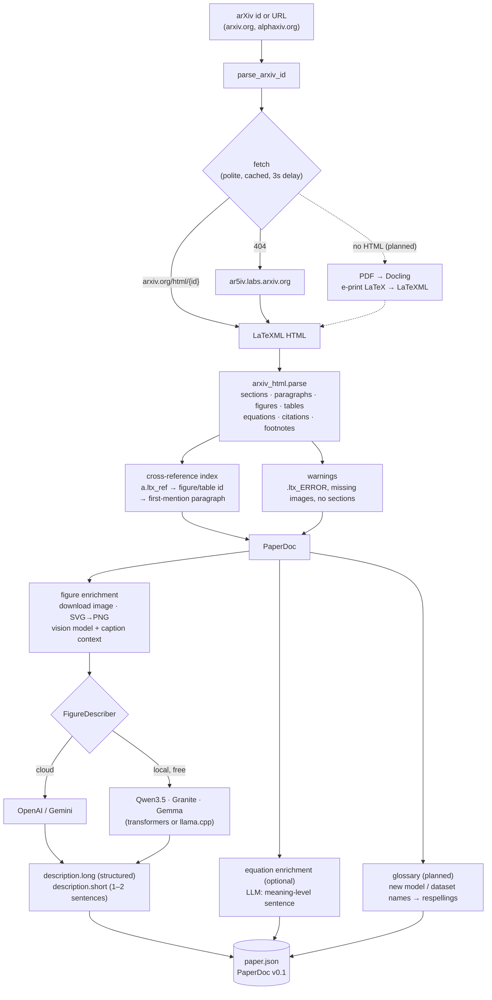
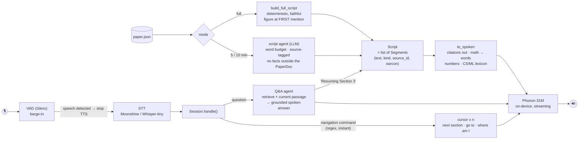

# Architecture

hearxiv has two phases with very different cost profiles:

| Phase | When | Cost | Output |
|---|---|---|---|
| **Ingest** (parse + enrich) | once per paper version | the expensive part: vision model per figure, optional LLM per long equation | `paper.json` (a `PaperDoc`) |
| **Listen** (script + speak + converse) | every time someone listens | cheap: deterministic script for full mode; one LLM call for a summary; one per question | audio stream, answers |

Because the `PaperDoc` is a plain, versioned JSON file, it can be cached, shared (one person's
ingest serves everyone), hand-corrected, and consumed by any front end.

## 1. Processing one paper (ingest)



## 2. Listening and talking (runtime)



## 3. Barge-in sequence

```mermaid
sequenceDiagram
    participant L as Listener
    participant P as Player (front end)
    participant S as Session
    participant Q as Q&A agent
    participant T as Phonon TTS

    P->>T: stream(segment 41)
    T-->>L: "...we scale the dot products by one over square root of d sub k..."
    L->>P: (starts speaking)
    P->>T: stop (exit stream; generation halts)
    P->>P: earcon "listening"
    L->>P: "why do they do that?"
    P->>S: handle("why do they do that?") [cursor=41]
    S->>Q: question + current passage (seg 41) + retrieved excerpts
    Q-->>S: "In Section 3.2.1 the authors say large dot products push softmax into tiny gradients..."
    S-->>P: Reply(say=answer + "Resuming Section 3.2.1", resume_at=41)
    P->>T: stream(answer) then stream(segment 41 from its start)
```

## Components and where they live

| Concern | Module | Notes |
|---|---|---|
| Data model | `src/hearxiv/schema.py` | `PaperDoc`, `Figure`, `Table`, `Equation`, `Mention` |
| Fetch | `src/hearxiv/ingest/fetch.py` | arxiv.org/html → ar5iv; descriptive User-Agent; cache by id+version |
| Parse | `src/hearxiv/ingest/arxiv_html.py` | LaTeXML selectors; first-mention index; honest warnings |
| Enrich | `src/hearxiv/ingest/enrich.py` | figure descriptions, SVG rendering, equation paraphrase |
| Vision models | `src/hearxiv/vision/` | one `FigureDescriber` interface: `openai:`, `gemini:`, `hf:`, `local:` |
| LLM | `src/hearxiv/llm.py` | OpenAI-compatible client for OpenAI / Gemini / llama.cpp / Ollama |
| Script | `src/hearxiv/narrate/script.py` | full (deterministic) and N-minute (agent) modes |
| Speech text | `src/hearxiv/narrate/spoken.py` + `lexicon/cs_ml.json` | see [pronunciation.md](pronunciation.md) |
| TTS | `src/hearxiv/tts/phonon.py` | Phonon 31M, streaming, earcons |
| Conversation | `src/hearxiv/agent/session.py`, `qa.py` | command grammar + grounded Q&A |
| Front ends | `extension/` (MV3), CLI | see [roadmap.md](roadmap.md) |

## Why these choices

- **HTML first, not PDF.** LaTeXML keeps the real section tree, equation LaTeX, and explicit
  figure links. SciA11y found that broken headings are the most damaging extraction error for blind
  readers; PDF extraction is the fallback, not the default.
- **Full mode is deterministic.** Every sentence comes from the paper. LLMs only write figure
  descriptions, optional equation paraphrases and the short summaries, which are labelled as summaries.
- **No agent framework.** The pipeline is a fixed sequence of steps; plain SDK calls make it easy to
  read and fork. "Agents" here are prompt + schema + validation, nothing more.
- **Provider-agnostic by URL.** OpenAI, Gemini, llama.cpp, Ollama and LM Studio all speak the
  OpenAI protocol, so zero-cost local runs are a config change: `HEARXIV_LLM=local:...`.
