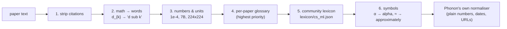

# Pronouncing CS / ML jargon

## The constraint

Phonon (Gradium, 31M) is **grapheme-based**: it reads text. There is no IPA input, no SSML and no
lexicon hook. The only lever is to **rewrite the text before synthesis** into spellings the model
already says correctly. This is the same thing a human does when writing "ray-loo" on a
presenter's notes.

## The layered approach

1. **Community lexicon**, `src/hearxiv/narrate/lexicon/cs_ml.json`. About 150 curated terms:
   - acronyms said as words (LoRA → "lora", CUDA → "cooda"),
   - acronyms spelled out (RLHF → "R L H F"),
   - names (ResNet → "rez-net", CIFAR → "see-far", MNIST → "em-nist", arXiv → "archive"),
   - abbreviations (e.g. → "for example", et al. → "and colleagues").

   Matching is case-sensitive and on whole words, so "GAN" changes and "began" does not. Each entry
   may also carry `ipa` for phoneme-capable engines (Kokoro/misaki, SSML voices), so the same file
   serves future backends.
2. **Per-paper glossary**, `PaperDoc.glossary`. New model and dataset names coined by the paper
   ("we call our model Glorpformer"). It overrides the community lexicon.
3. **Fallback for unknown all-caps tokens:** spell them out letter by letter (planned). That's
   safer than letting the TTS guess.

## Ideas for building the lexicon and glossary (open problems)

- **Mine candidates automatically.** Collect capitalised and mixed-case tokens (`[A-Z][a-z]*[A-Z]\w*`,
  all-caps of 2–6 letters) across a few thousand arXiv cs.* abstracts, ranked by frequency. The top
  500 cover most of what listeners hear.
- **Let an LLM propose, and let humans approve.** For each candidate, an LLM proposes a respelling
  and a confidence. Low-confidence or disputed items (e.g. "ViT": "vit" or "V I T"?) go to a
  GitHub-issue form for community votes. Never auto-merge.
- **Check with ASR round-trips** (cheap, automatic). Synthesise "We use {respelling}." with Phonon,
  transcribe it with Whisper or Moonshine, and check that the transcript matches the intended term.
  A respelling that the ASR hears as something else probably sounds wrong to people too. This can
  run in CI on every lexicon pull request.
- **Use authors' own pronunciations.** When a talk video exists, the way the authors say the name
  is the ground truth. Contributors can cite it in the lexicon entry (`"source": "NeurIPS talk 12:31"`).
- **Build per-paper glossaries at ingest.** One LLM call over the paper's capitalised tokens that
  aren't in the lexicon, returning `{term: respelling}`, stored in `paper.json` and hand-editable.
- **Let listeners report mistakes.** A "that was mispronounced" voice command records the segment
  and the token nearest the cursor, building a queue of real errors.
- **Prefer meaning-level rewrites for symbols.** For dense notation the best "pronunciation" is
  often a paraphrase ("the loss summed over tokens") rather than a reading. That's handled by the
  equation depth levels in [agents.md](agents.md).

## Testing

`tests/test_spoken.py` covers the normaliser. The planned
`notebooks/02_pronunciation_roundtrip.ipynb` will run the ASR round-trip over the whole lexicon and
report terms whose transcript doesn't match.
